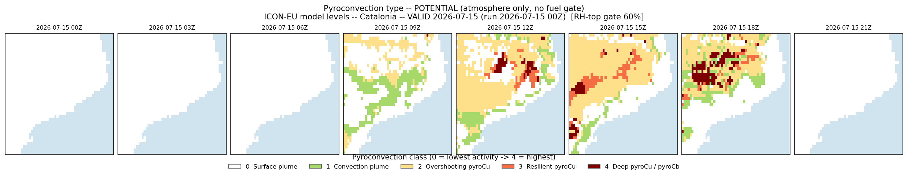

## What this product is

The pyflam **hybrid** atmosphere (ICON-EU native model levels) applied **outside Italy**, over
Catalonia. It is the same model-level profile path that drives the Tuscany hybrid product, but
with two deliberate differences forced by the region:

- **ICON-EU only, no ICON-2I.** The ICON-2I 2.2 km product is an Italy-only domain, so over
 Spain there is no ICON-2I for the surface fields or the render grid. The atmosphere, the
 surface state and the grid here are **all ICON-EU** (6.5 km native model levels). Sea is
 masked out via the land fraction.
- **No fuel gate -- POTENTIAL map only.** There is no fuel/canopy landscape (`.lcp`) for
 Catalonia, so fireline intensity cannot be computed and the 10 MW/m fuel gate cannot be
 applied. Only the **potential** (atmospheric upper-bound) map is produced.

## How to read it -- this is an upper bound, not an expectation

The potential map assigns a class **assuming a pyroCu-capable fire in every cell**. Classes 2–4
therefore mean *"the atmosphere would support this pyroconvection type **if** a sufficiently
intense fire ( >= 10 MW/m fireline intensity) occurred here"* -- not that such a fire exists or is
likely. Without the fuel gate there is **no restriction to realisable fire power**, so on a
well-mixed summer afternoon the higher classes cover large areas. Read this as the atmospheric
*ceiling* for the day, to be intersected with where fires and fuels actually are.

## Method

Per cell, from the ICON-EU model levels: heights from the model half-level field (HHL); mixing
depth from the **bulk Richardson number** (first Rib >= 0.33 above 200 m AGL, referenced to the
2 m / 10 m state); LCL from the exact **Bolton (1980)** formula; humidity at the ABL top from
the model RH; cap gamma-theta over ABL+200 m to ABL+1200 m.

The **mixed-layer dtheta/dz is a genuine least-squares measurement** across the model levels inside
the mixed layer (~7–9 levels at midday, versus a mixing-depth *proxy* on the 5 pressure levels
of the Italian product). This is the whole reason the model-level path exists.

The fifth diagnostic -- distance to the height of maximum wind shear -- is **not computed**, so
the 4-diagnostic ladder runs. Omitting the shear clause (a *necessary* condition for the top
class) makes class 4 somewhat easier to reach than in the full method; treat deep pyroCu/pyroCb
as an alert to inspect the column, not a calibrated probability.

## Potential class distribution -- % of land cells

| Hour | levels in ML | 0 surface | 1 convection | 2 overshoot | 3 resilient | 4 deep |
|:--|--:|--:|--:|--:|--:|--:|
| 00Z | 1 | 100.0 | 0.0 | 0.0 | 0.0 | 0.0 |
| 03Z | 1 | 100.0 | 0.0 | 0.0 | 0.0 | 0.0 |
| 06Z | 2 | 100.0 | 0.0 | 0.0 | 0.0 | 0.0 |
| 09Z | 4 | 65.0 | 19.2 | 15.8 | 0.0 | 0.0 |
| 12Z | 7 | 34.3 | 11.7 | 54.0 | 0.0 | 0.0 |
| 15Z | 6 | 33.0 | 5.1 | 61.9 | 0.0 | 0.0 |
| 18Z | 3 | 45.1 | 14.6 | 39.8 | 0.1 | 0.5 |
| 21Z | 1 | 100.0 | 0.0 | 0.0 | 0.0 | 0.0 |

Diurnal envelope as expected: nothing overnight (shallow nocturnal ABL -- median 201 m -- below
the 600 m gate, and too few levels in the mixed layer to classify), a convection-plume onset at
09Z (ABL ~700 m, still forming), an overshooting-pyroCu peak 12–15Z (ABL 2.7–3.0 km, LCL/ABL
~ 1.06), and a handful of deep pyroCu/pyroCb cells over the Pyrenees at 18Z, then collapse.

{width=100%}

## Class scale (low -> high pyroconvective activity)

| Level | Colour | Class | Meaning |
|:--:|:--|:--|:--|
| 0 | white | Surface plume | Buoyant smoke plume; no significant cloud development. |
| 1 | green | Convection plume | Plume penetrates a stable mixed layer; condensation possible, no pyroCu. |
| 2 | yellow | Overshooting pyroCu | Brief pyrocumulus; cloud base above the mixing height (LCL/ABL > 1). |
| 3 | orange | Resilient pyroCu | Persistent pyrocumulus in an unstable column (LCL/ABL < 1). |
| 4 | dark red | Deep pyroCu / pyroCb | Deep pyroconvection / pyrocumulonimbus; weak upper cap lets the plume deepen. |

## Classification thresholds (4-diagnostic ladder; Castellnou et al. 2022)

| Diagnostic | Threshold | Effect |
|:--|:--|:--|
| Mixed-layer dtheta/dz (least-squares fit, in the mixed layer) | > 1.1e-3 K/m (stable) | Convection plume only -- no pyroCu |
| Mixed-layer dtheta/dz | <= 1.1e-3 K/m (neutral/unstable) | Column is pyroCu-capable |
| LCL / ABL ratio | 1.0 – 1.60 | Overshooting pyroCu (brief) |
| LCL / ABL ratio | < 1.0 | Resilient pyroCu (persistent) |
| LCL / ABL ratio | <= 1.10 (+ conditions below) | Admissible for deep pyroCu / pyroCb |
| Cap gamma-theta (ABL+200 m -> ABL+1200 m) | <= 4.2e-3 K/m (weak cap) | Permits deepening to pyroCb |
| Cap gamma-theta | >= 4.8e-3 K/m (strong cap) | Inhibits deepening (resilient at most) |
| RH at the ABL top (mean, ABL +/- 150 m) | >= 80 % | Required for classes 3 and 4 |
| Shear-maximum distance / ABL | <= 0.30 | Required for class 4 **in the 5-diagnostic ladder only** -- not computed here |
| ABL depth | < 600 m | Held at surface plume (mixing too shallow) |
| Model levels inside the mixed layer | < 3 | Cell not classified (kept as surface plume) |
| Fireline-intensity fuel gate | -- | **Not applied** (no fuel map for Catalonia) -- potential map only |

## Reference cases (Castellnou et al. 2022, Table 1)

The paper's labelled 2021-campaign events, which anchor the classification ladder.

| Case | Observed type | LCL/ABL | ML dtheta/dz | gamma-theta (700–500) |
|:--|:--|:--:|:--|:--:|
| T21 | Convection plume | -- | stable | -- |
| SCQ32 | Overshooting pyroCu | > 1 | neutral/unstable | -- |
| M11 | Resilient pyroCu | < 1 | unstable | 4.2e-3 (resilient cap) |
| SCQ41 | pyroCu, not pyroCb | < 1 | unstable | 5.1e-3 (strong cap) |
| SCQ51 | Deep pyroCu / pyroCb | < 1 | unstable | 3.9e-3 (weak cap) |

## Limitations

- **No fuel gate.** This is the atmospheric ceiling only. It overstates realisable activity
 because it assumes an intense fire everywhere; the operational (fuel-gated) map cannot be made
 for Catalonia without a fuel/canopy landscape.
- **6.5 km resolution** (ICON-EU), coarser than the 2.2 km Italian grid; the coast and Pyrenees
 are correspondingly smoothed.
- The 1.1e-3 K/m mixed-layer threshold sits inside the +/-2.6e-4 K/m radiosonde-validated error
 bar, so class *counts* are indicative, not calibrated.
- **Not validated against observed pyroCu in Catalonia.** Castellnou et al. (2022) is a Catalan
 dataset, so a local validation here is the natural next step.
- No province/administrative borders drawn (no boundary file loaded for Spain); land/sea only.

Forcing: ICON-EU 6.5 km native model levels (DWD open data, CC-BY): geopotential-height (HHL),
temperature, specific humidity, pressure and wind on the lowest ~24 model levels, plus the
2 m / 10 m surface state and land fraction. Classifier: pyflam.pyroconvection_type
(bulk-Richardson ABL, Bolton LCL, measured mixed-layer dtheta/dz, cap gamma-theta, ABL-top RH; no surface
CAPE; no fuel gate). Generated by scripts/validation/catalonia_iconeu.py.
