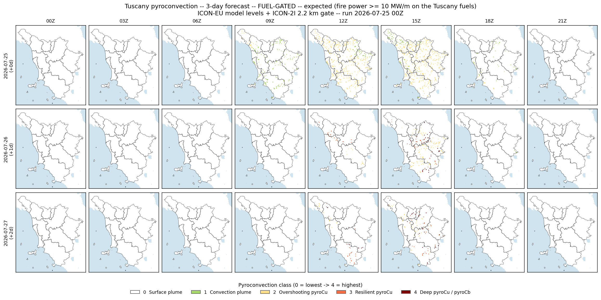
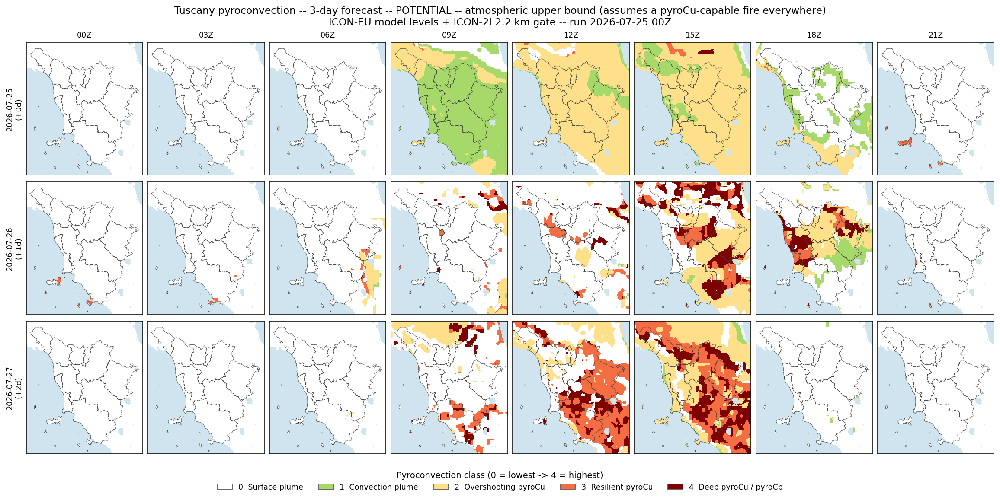
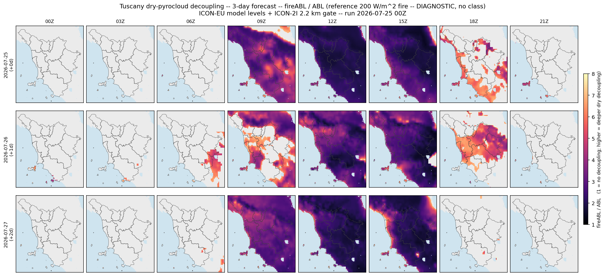

## 3-day forecast

Three valid days from the single 2026-07-25 00Z run (day 0, +1, +2), using the day+1/+2
forecast steps in the same ICON-EU + ICON-2I datasets. Each day is a **complete 24 h cycle,
3-hourly, starting at 00Z of the run day** (00Z, 03Z, 06Z, 09Z, 12Z, 15Z, 18Z, 21Z), so the three day-rows of every figure
are directly comparable and day 0 opens at the run's own initial time. Panels are the Tuscany
domain with ISTAT province borders; the sea is masked. Atmosphere from ICON-EU native model
levels (bulk-Richardson ABL, Bolton LCL, measured mixed-layer dtheta/dz, cap gamma-theta,
ABL-top RH, shear); the 10 MW/m fuel gate uses ICON-2I's 2.2 km surface fields on the Tuscany
.lcp fuels. See scripts/validation/README.md for the diagnostic validation (radiosondes + ERA5).

Three map series follow. The **fuel-gated** map is the expected product; the **potential** map
is the atmospheric upper bound (assumes a pyroCu-capable fire in every cell); the
**dry-pyrocloud decoupling** map is the dry counterpart to both, and carries no class label.
Read class *counts* as indicative.

## Fuel-gated (expected)

{width=100%}

## Potential (atmospheric upper bound)

{width=100%}

## Dry-pyrocloud decoupling -- DIAGNOSTIC (no class label)

{width=100%}

The **decoupling ratio** fireABL / ABL is how high a reference intense fire
(200 W/m^2 convective flux) would grow its own boundary layer by
*sensible heat alone*, divided by the ambient ABL. It is the **dry** counterpart to the moist
class maps above (Castellnou et al. 2022; Castellnou Ribau et al. 2024): values well above 1
mark deep, hot, dry columns where a fire can punch through and decouple from the surface *even
where the moist ladder scores low*, which is exactly the situation the gated map under-reports.
Like the potential map it assumes a fire everywhere -- here a fixed reference flux rather than
a computed one -- so it is an upper bound, not an expectation, and no dry/moist LCL split is
applied (the +1 km literature offset is not supported by the GRAF prototype labels). fireABL
from `pyflam.atmosphere.fire_induced_abl_grid`, the parcel intersected with the real theta(z)
stack; cells the classifier rejects (no usable column, or ABL below 600 m) are left
blank rather than painted with a bare quotient.

## Dry decoupling -- daytime, % of the classifiable land

| Day | Hour | % grid classifiable | % area ratio >= 2 | % area ratio >= 3 | max ratio |
|:--|:--|--:|--:|--:|--:|
| 2026-07-25 | 09Z | 80.9 | 100.0 | 76.7 | 8.1 |
| 2026-07-25 | 12Z | 91.8 | 61.7 | 26.3 | 9.1 |
| 2026-07-25 | 15Z | 93.1 | 71.8 | 40.0 | 7.7 |
| 2026-07-25 | 18Z | 48.7 | 100.0 | 100.0 | 9.1 |
| 2026-07-26 | 09Z | 54.0 | 100.0 | 92.2 | 8.7 |
| 2026-07-26 | 12Z | 86.9 | 89.9 | 52.3 | 8.2 |
| 2026-07-26 | 15Z | 87.6 | 82.7 | 46.6 | 8.8 |
| 2026-07-26 | 18Z | 44.5 | 100.0 | 100.0 | 9.7 |
| 2026-07-27 | 09Z | 82.2 | 99.9 | 62.0 | 9.3 |
| 2026-07-27 | 12Z | 76.5 | 60.1 | 16.1 | 10.2 |
| 2026-07-27 | 15Z | 72.9 | 62.7 | 25.4 | 8.0 |
| 2026-07-27 | 18Z | 0.6 | 100.0 | 100.0 | 11.8 |

*% grid classifiable* is the share of the domain with a usable column at that hour (ABL above
600 m); the two ratio columns are percentages **of that share**, not of Tuscany.
The denominator collapses towards sunset as the mixed layer decays, so an 18Z row can read
100% off a small residual area -- read it together with the classifiable column.

## Fuel-gated class distribution -- daytime, % of land cells (13907 land cells)

| Day | Hour | surface | convect | overshoot | resilient | deep |
|:--|:--|--:|--:|--:|--:|--:|
| 2026-07-25 | 09Z | 98.6 | 1.2 | 0.2 | 0.0 | 0.0 |
| 2026-07-25 | 12Z | 96.7 | 0.3 | 3.0 | 0.0 | 0.0 |
| 2026-07-25 | 15Z | 96.1 | 0.6 | 3.3 | 0.0 | 0.0 |
| 2026-07-25 | 18Z | 99.6 | 0.3 | 0.1 | 0.0 | 0.0 |
| 2026-07-26 | 09Z | 100.0 | 0.0 | 0.0 | 0.0 | 0.0 |
| 2026-07-26 | 12Z | 99.7 | 0.0 | 0.1 | 0.2 | 0.0 |
| 2026-07-26 | 15Z | 98.6 | 0.0 | 0.9 | 0.2 | 0.3 |
| 2026-07-26 | 18Z | 100.0 | 0.0 | 0.0 | 0.0 | 0.0 |
| 2026-07-27 | 09Z | 100.0 | 0.0 | 0.0 | 0.0 | 0.0 |
| 2026-07-27 | 12Z | 99.6 | 0.0 | 0.1 | 0.1 | 0.1 |
| 2026-07-27 | 15Z | 99.2 | 0.0 | 0.4 | 0.2 | 0.2 |
| 2026-07-27 | 18Z | 100.0 | 0.0 | 0.0 | 0.0 | 0.0 |

Classes: 0 surface plume, 1 convection plume, 2 overshooting pyroCu, 3 resilient pyroCu,
4 deep pyroCu/pyroCb. Per-hour class and diagnostic GeoTIFFs (ABL, LCL, LCL/ABL, ML dtheta/dz,
cap, RH-top, fireABL, decoupling) accompany this report in `rasters_hybrid_<day>/`.
Generated by scripts/forecast_3day_tuscany.py.
