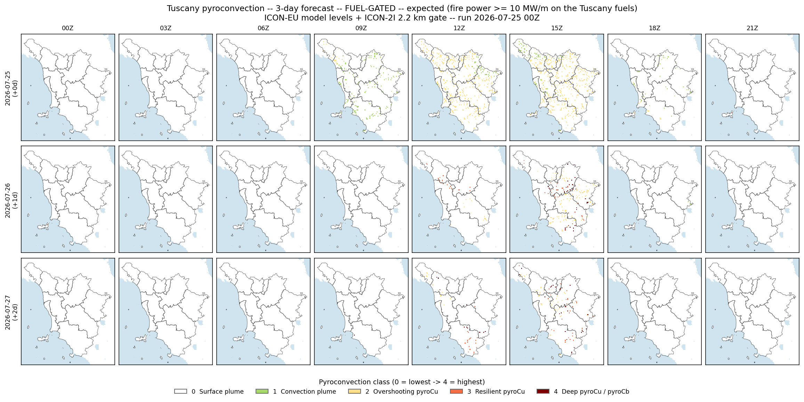
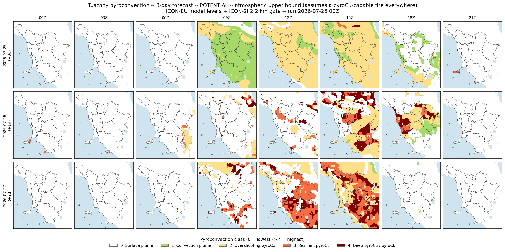
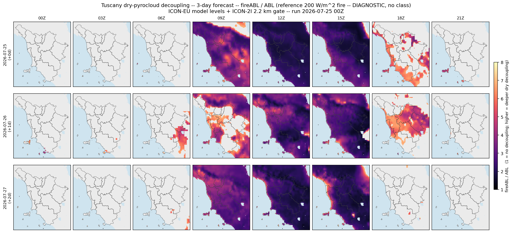

## Overview

Three valid days from the single **2026-07-25 00Z** run (day 0, +1, +2), using the
day+1/+2 forecast steps in the same ICON-EU + ICON-2I datasets. Each day is a complete 24 h
cycle, 3-hourly, **starting at 00Z of the run day** (00Z, 03Z, 06Z, 09Z, 12Z, 15Z, 18Z, 21Z); panels are the Tuscany
domain with ISTAT province borders. The atmospheric pyroconvection classification is the
hybrid product (ICON-EU native model levels for the profile -- bulk-Richardson ABL, Bolton
LCL, measured mixed-layer dtheta/dz, cap gamma-theta, ABL-top RH -- with the 10 MW/m fuel
gate on ICON-2I's 2.2 km surface fields over the Tuscany .lcp fuels). Three map series
follow; per-province tables summarise the pyroconvection potential, the dry-pyrocloud
decoupling and the Canadian fire-weather danger for each of the ten Tuscany provinces.

## Fuel-gated pyroconvection (expected)

{width=100%}

## Potential pyroconvection (atmospheric upper bound)

{width=100%}

## Dry-pyrocloud decoupling -- DIAGNOSTIC (no class label)

{width=100%}

The decoupling ratio fireABL / ABL is how high a reference intense fire
(200 W/m^2 convective flux) would grow its own boundary layer by
*sensible heat alone*, divided by the ambient ABL. It is the **dry** counterpart to the two
class maps (Castellnou et al. 2022; Castellnou Ribau et al. 2024): ratios well above 1 mark
deep, hot, dry columns where a fire can decouple from the surface *even where the moist ladder
scores low*. Like the potential map it assumes a fire everywhere (a fixed reference flux), so
it is an upper bound and not a calibrated class -- no dry/moist LCL split is applied. Columns
the classifier rejects (ABL below 600 m, or no usable profile) are left blank.

## Per-province pyroconvection potential metrics

Peak-of-day (09-18Z) statistics per province. *Pot peak* / *Gate peak* are the highest
class reached (0 surface plume -> 4 deep pyroCu/pyroCb); *%pyroCu* is the maximum daytime
areal coverage of class >= 2 (pyrocumulus), *%deep* of class 4. *Decoup max* is the peak
daytime fireABL/ABL ratio over the province -- read it alongside the classes, since a high
ratio with a low class is the dry-decoupling case the moist ladder does not score. LCL/ABL,
ABL depth and the minimum ABL-top RH are the noon column diagnostics over the province's
classified land. Classes: convection_plume Convection plume, deep_pyrocu_pyrocb Deep pyroCu / pyroCb, overshooting_pyrocu Overshooting pyroCu, resilient_pyrocu Resilient pyroCu, surface_plume Surface plume.

| Province | Day | Pot peak | Pot %pyroCu | Pot %deep | Gate peak | Gate %pyroCu | Decoup max | LCL/ABL | ABL m | RH-top min |
|:--|:--|--:|--:|--:|--:|--:|--:|--:|--:|--:|
| Grosseto | 2026-07-25 | 2 | 93.3 | 0.0 | 2 | 7.3 | 7.0 | 1.15 | 1713.0 | 19.0 |
| Livorno | 2026-07-25 | 2 | 82.8 | 0.0 | 2 | 7.9 | 8.1 | 1.23 | 1303.0 | 19.0 |
| Siena | 2026-07-25 | 2 | 100.0 | 0.0 | 2 | 7.8 | 7.1 | 1.29 | 2026.0 | 22.0 |
| Pisa | 2026-07-25 | 2 | 96.8 | 0.0 | 2 | 7.6 | 8.8 | 1.34 | 2085.0 | 20.0 |
| Arezzo | 2026-07-25 | 2 | 100.0 | 0.0 | 2 | 10.7 | 6.8 | 1.53 | 1948.0 | 17.0 |
| Firenze | 2026-07-25 | 2 | 98.7 | 0.0 | 2 | 10.6 | 7.7 | 1.44 | 2037.0 | 24.0 |
| Prato | 2026-07-25 | 2 | 100.0 | 0.0 | 2 | 15.4 | 7.0 | 1.32 | 1890.0 | 24.0 |
| Pistoia | 2026-07-25 | 2 | 100.0 | 0.0 | 2 | 13.4 | 6.7 | 1.31 | 1828.0 | 24.0 |
| Lucca | 2026-07-25 | 2 | 94.5 | 0.0 | 2 | 12.2 | 9.1 | 1.3 | 1818.0 | 28.0 |
| Massa-Carrara | 2026-07-25 | 2 | 97.5 | 0.0 | 2 | 6.5 | 8.5 | 1.11 | 1715.0 | 27.0 |
| Grosseto | 2026-07-26 | 4 | 86.2 | 26.4 | 4 | 4.2 | 7.0 | 0.74 | 1619.0 | 43.0 |
| Livorno | 2026-07-26 | 4 | 65.0 | 17.8 | 0 | 0.0 | 7.1 | 0.8 | 1114.0 | 44.0 |
| Siena | 2026-07-26 | 4 | 88.7 | 18.1 | 4 | 5.0 | 7.5 | 0.64 | 1975.0 | 41.0 |
| Pisa | 2026-07-26 | 4 | 97.0 | 49.4 | 4 | 0.9 | 7.0 | 0.77 | 1314.0 | 45.0 |
| Arezzo | 2026-07-26 | 4 | 89.4 | 19.1 | 4 | 6.4 | 7.2 | 0.64 | 1555.0 | 41.0 |
| Firenze | 2026-07-26 | 4 | 95.4 | 26.3 | 4 | 4.8 | 8.0 | 0.74 | 1211.0 | 48.0 |
| Prato | 2026-07-26 | 2 | 60.4 | 0.0 | 2 | 4.4 | 6.9 | 0.69 | 1118.0 | 47.0 |
| Pistoia | 2026-07-26 | 4 | 49.6 | 1.7 | 2 | 2.5 | 7.0 | 0.66 | 1064.0 | 46.0 |
| Lucca | 2026-07-26 | 4 | 35.0 | 18.4 | 3 | 2.3 | 7.1 | 0.69 | 1082.0 | 47.0 |
| Massa-Carrara | 2026-07-26 | 4 | 34.8 | 12.7 | 3 | 0.6 | 6.9 | 0.64 | 948.0 | 65.0 |
| Grosseto | 2026-07-27 | 4 | 83.9 | 28.9 | 4 | 2.1 | 8.0 | 0.92 | 1839.0 | 45.0 |
| Livorno | 2026-07-27 | 4 | 72.2 | 6.9 | 2 | 0.3 | 8.0 | 0.92 | 1219.0 | 48.0 |
| Siena | 2026-07-27 | 4 | 100.0 | 42.9 | 4 | 2.5 | 5.5 | 0.86 | 2064.0 | 34.0 |
| Pisa | 2026-07-27 | 4 | 66.4 | 7.6 | 4 | 2.1 | 6.7 | 0.88 | 1697.0 | 45.0 |
| Arezzo | 2026-07-27 | 4 | 97.1 | 17.6 | 4 | 1.4 | 7.0 | 0.87 | 2131.0 | 37.0 |
| Firenze | 2026-07-27 | 4 | 100.0 | 20.4 | 4 | 2.4 | 4.1 | 0.87 | 1898.0 | 44.0 |
| Prato | 2026-07-27 | 4 | 100.0 | 9.9 | 4 | 4.4 | 4.1 | 0.89 | 1827.0 | 44.0 |
| Pistoia | 2026-07-27 | 4 | 100.0 | 41.6 | 4 | 2.9 | 5.1 | 0.86 | 1635.0 | 43.0 |
| Lucca | 2026-07-27 | 4 | 80.9 | 21.4 | 4 | 2.3 | 7.0 | 0.91 | 1442.0 | 50.0 |
| Massa-Carrara | 2026-07-27 | 4 | 70.5 | 19.3 | 4 | 2.8 | 7.3 | 0.88 | 1314.0 | 48.0 |

## Per-province Canadian FWI System (12Z)

Province-mean of the full FWI System at solar noon on each valid day: the moisture **codes**
FFMC (fine fuels), DMC (duff), DC (deep drought); the **indices** ISI (spread) and BUI
(buildup); and the final **FWI**. The slow DMC/DC drought memory is seeded from
live ERA5 reanalysis, 28 d ending 2026-07-24 (SIR-rain-corrected where the gauge window is current), giving a run-day antecedent state of **FFMC 93.4 / DMC
117.5 / DC 225.0**; that state is then carried forward through the three
forecast days on the run's own 12Z weather. Forecast rain is taken as 0 (dry-spell
assumption); a wetting event would lower FFMC/DMC and the indices. Danger classes follow the
EFFIS FWI scale.

| Province | Day | FFMC | DMC | DC | ISI | BUI | FWI | Danger |
|:--|:--|--:|--:|--:|--:|--:|--:|:--|
| Grosseto | 2026-07-25 | 93.0 | 122.4 | 234.3 | 16.2 | 122.0 | 46.8 | very high |
| Livorno | 2026-07-25 | 92.5 | 122.1 | 234.2 | 16.2 | 121.8 | 46.3 | very high |
| Siena | 2026-07-25 | 94.7 | 123.5 | 234.4 | 15.7 | 123.1 | 45.9 | very high |
| Pisa | 2026-07-25 | 94.6 | 123.5 | 234.5 | 16.0 | 123.1 | 46.4 | very high |
| Arezzo | 2026-07-25 | 94.6 | 123.2 | 234.1 | 14.9 | 122.8 | 44.3 | very high |
| Firenze | 2026-07-25 | 94.7 | 123.3 | 234.2 | 14.1 | 122.9 | 43.0 | very high |
| Prato | 2026-07-25 | 94.1 | 122.9 | 234.0 | 12.8 | 122.5 | 40.2 | very high |
| Pistoia | 2026-07-25 | 93.6 | 122.5 | 233.8 | 12.6 | 122.1 | 39.9 | very high |
| Lucca | 2026-07-25 | 92.8 | 122.0 | 233.8 | 11.5 | 121.7 | 37.4 | high |
| Massa-Carrara | 2026-07-25 | 91.6 | 121.2 | 233.5 | 11.1 | 120.9 | 36.4 | high |
| Grosseto | 2026-07-26 | 89.5 | 125.4 | 243.3 | 12.6 | 125.1 | 39.9 | very high |
| Livorno | 2026-07-26 | 88.6 | 124.8 | 243.0 | 10.7 | 124.5 | 35.9 | high |
| Siena | 2026-07-26 | 90.5 | 126.9 | 243.4 | 15.8 | 126.5 | 45.4 | very high |
| Pisa | 2026-07-26 | 89.7 | 126.6 | 243.5 | 13.0 | 126.2 | 40.9 | very high |
| Arezzo | 2026-07-26 | 86.4 | 124.8 | 242.1 | 6.2 | 124.5 | 23.6 | high |
| Firenze | 2026-07-26 | 89.1 | 126.1 | 243.0 | 11.0 | 125.7 | 35.9 | high |
| Prato | 2026-07-26 | 88.4 | 125.4 | 242.6 | 8.4 | 125.0 | 30.6 | high |
| Pistoia | 2026-07-26 | 87.3 | 124.6 | 242.1 | 7.5 | 124.2 | 27.8 | high |
| Lucca | 2026-07-26 | 86.5 | 123.9 | 242.0 | 6.3 | 123.5 | 24.4 | high |
| Massa-Carrara | 2026-07-26 | 87.2 | 123.3 | 241.6 | 6.7 | 123.0 | 25.9 | high |
| Grosseto | 2026-07-27 | 89.1 | 128.7 | 252.2 | 8.8 | 128.4 | 31.5 | high |
| Livorno | 2026-07-27 | 88.5 | 127.9 | 252.1 | 6.7 | 127.5 | 26.5 | high |
| Siena | 2026-07-27 | 90.7 | 131.0 | 252.5 | 7.8 | 130.6 | 29.4 | high |
| Pisa | 2026-07-27 | 89.1 | 129.7 | 252.5 | 8.2 | 129.3 | 30.6 | high |
| Arezzo | 2026-07-27 | 88.3 | 128.2 | 250.8 | 4.6 | 127.8 | 20.3 | moderate |
| Firenze | 2026-07-27 | 90.1 | 130.2 | 252.0 | 6.6 | 129.8 | 26.2 | high |
| Prato | 2026-07-27 | 89.5 | 129.2 | 251.6 | 5.5 | 128.9 | 23.3 | high |
| Pistoia | 2026-07-27 | 88.5 | 128.0 | 250.8 | 5.2 | 127.7 | 22.0 | high |
| Lucca | 2026-07-27 | 87.8 | 127.0 | 250.6 | 5.7 | 126.7 | 23.3 | high |
| Massa-Carrara | 2026-07-27 | 88.3 | 126.6 | 250.2 | 6.7 | 126.2 | 26.1 | high |

Generated by scripts/forecast_3day_province_report.py. Pyroconvection: pyflam.pyroconvection_type
(hybrid). FWI: pyflam.fwi + pyflam.fire_weather_history (ERA5/SIR spin-up). CSV tables accompany
this report in the same folder.
