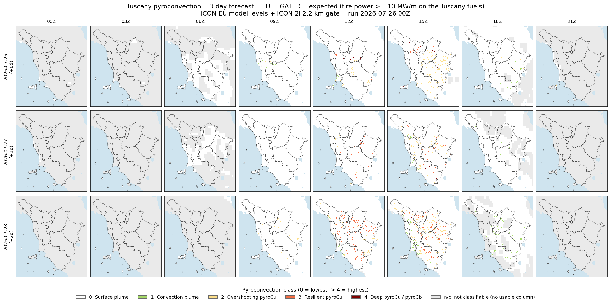
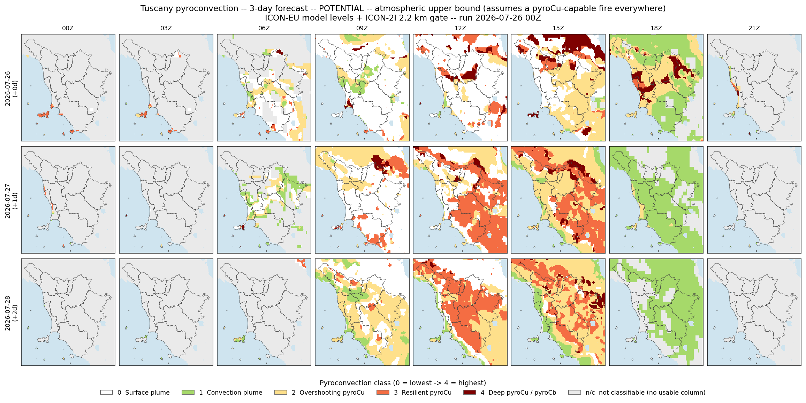
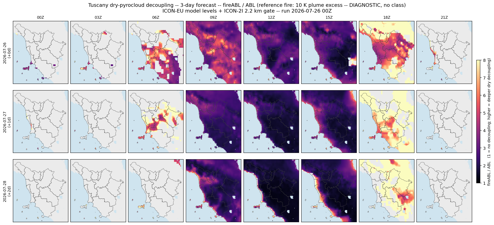

## 3-day forecast

Three valid days from the single 2026-07-26 00Z run (day 0, +1, +2), using the day+1/+2
forecast steps in the same ICON-EU + ICON-2I datasets. Each day is a **complete 24 h cycle,
3-hourly, starting at 00Z of the run day** (00Z, 03Z, 06Z, 09Z, 12Z, 15Z, 18Z, 21Z), so the three day-rows of every figure
are directly comparable and day 0 opens at the run's own initial time. Panels are the Tuscany
domain with ISTAT province borders; the sea is masked. Atmosphere from ICON-EU native model
levels (bulk-Richardson ABL, Bolton LCL, measured mixed-layer dtheta/dz, cap gamma-theta,
ABL-top RH, shear); the 10 MW/m fuel gate uses ICON-2I's 2.2 km surface fields on the Tuscany
.lcp fuels. See scripts/validation/README.md for the diagnostic validation (radiosondes + ERA5).

Three map series follow. The **fuel-gated** map is the expected product; the **potential** map
is the atmospheric upper bound (assumes a pyroCu-capable fire in every cell); the
**dry-pyrocloud decoupling** map is the dry counterpart to both, and carries no class label.
Read class *counts* as indicative.

## Fuel-gated (expected)

{width=100%}

## Potential (atmospheric upper bound)

{width=100%}

## Dry-pyrocloud decoupling -- DIAGNOSTIC (no class label)

{width=100%}

The **decoupling ratio** fireABL / ABL is how high a reference intense fire
(a 10 K plume temperature excess -- the intense end of the GRAF in-plume
measurements, 0.1-13.1 K) would grow its own boundary layer by
*sensible heat alone*, divided by the ambient ABL. It is the **dry** counterpart to the moist
class maps above (Castellnou et al. 2022; Castellnou Ribau et al. 2024): values well above 1
mark deep, hot, dry columns where a fire can punch through and decouple from the surface *even
where the moist ladder scores low*, which is exactly the situation the gated map under-reports.
Like the potential map it assumes a fire everywhere -- here a fixed reference flux rather than
a computed one -- so it is an upper bound, not an expectation, and no dry/moist LCL split is
applied (the +1 km literature offset is not supported by the GRAF prototype labels). fireABL
from `pyflam.atmosphere.fire_induced_abl_grid`, the parcel intersected with the real theta(z)
stack; cells the classifier rejects (no usable column, or ABL below 150 m) are left
blank rather than painted with a bare quotient.

## Dry decoupling -- daytime, % of the classifiable land

| Day | Hour | % grid classifiable | % area ratio >= 2 | % area ratio >= 3 | max ratio |
|:--|:--|--:|--:|--:|--:|
| 2026-07-26 | 09Z | 99.1 | 100.0 | 91.2 | 9.7 |
| 2026-07-26 | 12Z | 98.4 | 89.2 | 48.2 | 14.9 |
| 2026-07-26 | 15Z | 92.8 | 81.3 | 47.7 | 13.4 |
| 2026-07-26 | 18Z | 82.3 | 100.0 | 100.0 | 19.1 |
| 2026-07-27 | 09Z | 99.8 | 90.7 | 39.5 | 11.5 |
| 2026-07-27 | 12Z | 99.0 | 53.8 | 31.7 | 10.1 |
| 2026-07-27 | 15Z | 100.0 | 70.7 | 44.4 | 10.0 |
| 2026-07-27 | 18Z | 77.2 | 100.0 | 100.0 | 19.4 |
| 2026-07-28 | 09Z | 91.7 | 78.8 | 39.1 | 11.1 |
| 2026-07-28 | 12Z | 81.8 | 26.1 | 18.9 | 11.2 |
| 2026-07-28 | 15Z | 69.5 | 39.9 | 17.3 | 12.3 |
| 2026-07-28 | 18Z | 47.4 | 100.0 | 100.0 | 18.1 |

*% grid classifiable* is the share of the domain with a usable column at that hour (ABL above
150 m); the two ratio columns are percentages **of that share**, not of Tuscany.
The denominator collapses towards sunset as the mixed layer decays, so an 18Z row can read
100% off a small residual area -- read it together with the classifiable column.

## Fuel-gated class distribution -- daytime, % of land cells (13920 land cells)

| Day | Hour | surface | convect | overshoot | resilient | deep | n/c |
|:--|:--|--:|--:|--:|--:|--:|--:|
| 2026-07-26 | 09Z | 98.9 | 0.1 | 0.0 | 0.0 | 0.0 | 0.9 |
| 2026-07-26 | 12Z | 98.0 | 0.0 | 0.2 | 0.1 | 0.1 | 1.6 |
| 2026-07-26 | 15Z | 91.3 | 0.0 | 1.3 | 0.1 | 0.1 | 7.2 |
| 2026-07-26 | 18Z | 82.1 | 0.1 | 0.1 | 0.0 | 0.0 | 17.7 |
| 2026-07-27 | 09Z | 99.8 | 0.0 | 0.0 | 0.0 | 0.0 | 0.2 |
| 2026-07-27 | 12Z | 98.6 | 0.0 | 0.1 | 0.2 | 0.0 | 1.0 |
| 2026-07-27 | 15Z | 99.0 | 0.1 | 0.5 | 0.3 | 0.0 | 0.0 |
| 2026-07-27 | 18Z | 77.1 | 0.1 | 0.0 | 0.0 | 0.0 | 22.8 |
| 2026-07-28 | 09Z | 91.4 | 0.0 | 0.3 | 0.0 | 0.0 | 8.3 |
| 2026-07-28 | 12Z | 80.0 | 0.1 | 0.4 | 1.2 | 0.0 | 18.2 |
| 2026-07-28 | 15Z | 67.0 | 0.4 | 1.2 | 0.8 | 0.0 | 30.5 |
| 2026-07-28 | 18Z | 46.9 | 0.5 | 0.0 | 0.0 | 0.0 | 52.6 |

Classes: 0 surface plume, 1 convection plume, 2 overshooting pyroCu, 3 resilient pyroCu,
4 deep pyroCu/pyroCb. **n/c** is land with no classifiable column (no usable profile, or an
ABL below 150 m) -- distinct from class 0, which is the ladder's finding that the
column supports only a surface plume. Around sunset n/c takes most of the domain; those hours
carry no forecast, and must not be read as quiet ones.

## Evening columns and the residual layer

After sunset the convective layer collapses into a shallow stable layer, but the air above it
keeps the day's near-neutral profile -- the **residual layer**. A surface-referenced parcel
finds only the stable layer, and a mixed-layer dtheta/dz fitted inside that depth has no levels
to work with, so the whole domain used to fall out as unclassifiable. The gradient is now
fitted over the deeper of the parcel and residual depths (`atmosphere.residual_layer_grid`),
which by day reduces exactly to the parcel depth and only differs in the evening. **This changes
the evening classes**: those hours now carry a forecast where they previously carried none.
Treat them with more caution than the midday ones -- the diagnostic is newer and the residual
depth it returns still looks shallow against what the profile suggests.

Two further diagnostics ride along and are **not** used by the classifier: the entrainment-zone
jump `delta_theta` (the potential-temperature step a plume must cross to escape the mixed layer)
and `firecape` (Potter 2005, the CAPE of a fire-heated parcel). Both come from the source
method's variable set; neither gates a class here, because the penetration test they imply does
not yet discriminate at this product's reference fire strength. See
`docs/graf_vs_pyflam_2026-07-26.md`.

Per-hour class and diagnostic GeoTIFFs accompany this report in `rasters_hybrid_<day>/`:
ABL, parcel_ml, residual_ml, LCL, LCL/ABL, ML dtheta/dz, cap gamma-theta, RH-top, fireABL,
decoupling, delta_theta, firecape, penetration.
Generated by scripts/forecast_3day_tuscany.py.
