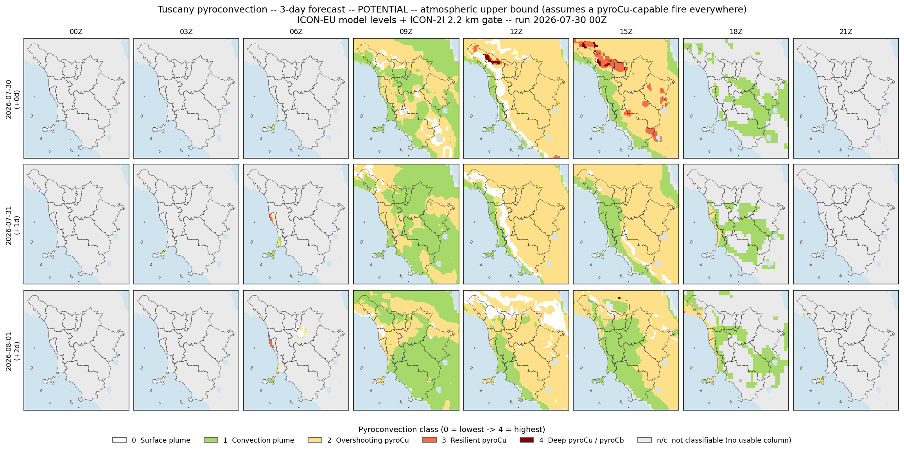
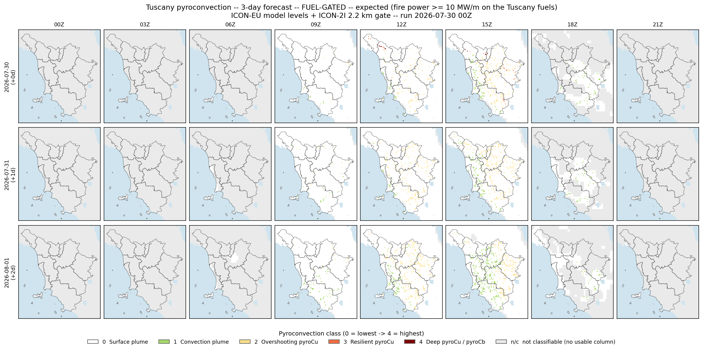
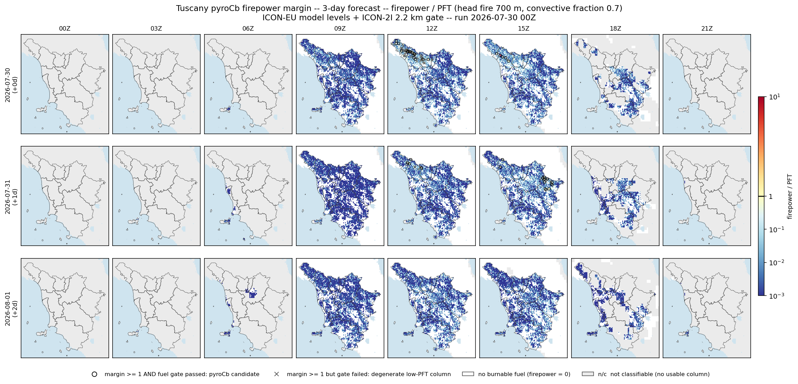
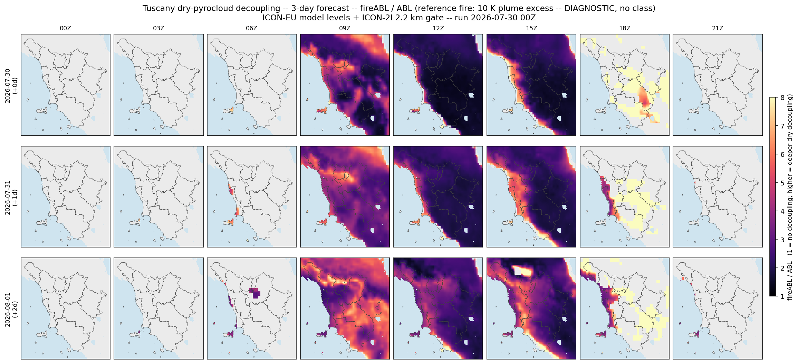

## 3-day forecast

Three valid days from the single 2026-07-30 00Z run (day 0, +1, +2), using the day+1/+2
forecast steps in the same ICON-EU + ICON-2I datasets. Each day is a **complete 24 h cycle,
3-hourly, starting at 00Z of the run day** (00Z, 03Z, 06Z, 09Z, 12Z, 15Z, 18Z, 21Z), so the three day-rows of every figure
are directly comparable and day 0 opens at the run's own initial time. Panels are the Tuscany
domain with ISTAT province borders; the sea is masked. Atmosphere from ICON-EU native model
levels (bulk-Richardson ABL, Bolton LCL, measured mixed-layer dtheta/dz, cap gamma-theta,
ABL-top RH, shear); the 10 MW/m fuel gate uses ICON-2I's 2.2 km surface fields on the Tuscany
.lcp fuels. See scripts/validation/README.md for the diagnostic validation (radiosondes + ERA5).

### The three questions this report answers

Each map answers one question. Read them in order -- but see the warning below question 3:
they are **not** nested, and a cell can pass question 3 while failing question 2.

| # | Question | Map | The test |
|:--|:--|:--|:--|
| 1 | What is the most intense pyroconvection this **column** could sustain? | POTENTIAL | the ladder, with no fire-side condition at all |
| 2 | Is there enough fire here to make a **plume** at all? | FUEL-GATED | Byram intensity >= 10 MW/m on the .lcp fuels |
| 3 | Is there enough fire here to make a **pyroCb** in this specific column? | PFT MARGIN | total firepower >= that column's own PFT |

Question 1 is a property of the atmosphere alone -- no fuel or land information enters it,
not even in deciding where it is defined. Questions 2 and 3 both condition on fire, and both
descend from the same Byram intensity field, but they are **not** the same test and they do
not agree: (2) compares power *per metre of front* against a fixed 10 MW/m constant, while
(3) converts that to a *total* power through an assumed head-fire length and compares it
against a threshold computed for that column. Cells routinely clear (2) and fail (3) by
orders of magnitude. Question 3 is the operationally decisive one and the hardest to satisfy.

A fourth map, **dry-pyrocloud decoupling**, supports all three: it is the dry counterpart to
the moist class ladder and carries no class label. Read class *counts* as indicative.

## 1. Potential -- what could this column sustain? (atmospheric upper bound)

{width=100%}

The ladder with the fire-side condition switched off entirely, so this is the atmosphere's
answer and nothing else: the most intense pyroconvection the column would support **given a
fire able to exploit it**. That fire is assumed, not computed -- it enters through the ladder's
calibrated thresholds, not through any fuel map. Use this map to see where the atmosphere is
the binding constraint, never as an expectation. Note that the classifier runs on any usable
column, including over water; the sea is masked in the figure but the underlying
`pyroconv_potential_*.tif` rasters are not, so zonal statistics taken straight off them must
be restricted to land.

## 2. Fuel-gated -- is there enough fire for a plume at all?

{width=100%}

The same ladder, on the same columns, with each cell forced to class 0 where the Tuscany .lcp
fuels and the forecast surface weather do not support **10 MW/m** of Byram fireline intensity
(Tedim et al. 2018). The gate is binary and one-directional: above the threshold the fuels
have no further influence, below it the cell reads surface plume whatever the atmosphere says.
This map therefore cannot exceed the potential map anywhere -- every difference between the
two is a cell knocked to 0 -- and it is the expected, operational product.

## 3. PFT margin -- is there enough fire for a pyroCb in *this* column?

{width=100%}

Per-cell **total** firepower divided by that column's own **PyroCb Firepower Threshold**
(Tory & Kepert 2021, eq. 31: `PFT = 0.3 z_fc^2 U_ML dtheta_fc`, in GW). At or above 1 the fire
is powerful enough to force a pyroCb *in that column*; below 1 it is not, however favourable
the atmosphere. The colour pivots exactly at 1 and the scale is logarithmic, because the field
spans four decades.

Byram intensity is power per metre of front and the PFT is a total power, so bridging them
needs an active head-fire length. Rather than assume one it is taken from the fire behaviour
the Wildfire Data Portal publishes -- the median over its 20 fires with both burn ratio and
ROS, 700 m -- with a convective fraction of 0.7 of the released heat entering the plume
(Tory & Kepert app. D). Both are assumptions, and the margin scales linearly with each: a
5 km head fire, which Tory & Kepert give for an extreme case, would multiply every margin here
by about seven. **Read the margin as an order of magnitude, not a number.**

This is why the map matters despite that caveat: over most of the burnable domain the margin
is not near 1 but two to three decades below it, so the conclusion "no pyroCb here" is robust
to the head-fire assumption in a way that a marginal cell would not be. Where the margin does
approach 1, the assumption becomes load-bearing and the cell deserves judgement rather than
the map.

Three exclusions are drawn differently on purpose: **grey** is a column the classifier
rejected (no atmosphere to test against), **white** is land with no burnable fuel (firepower
exactly zero -- a categorical no, not a small margin), and the sea is masked. The underlying
field is `diag_pft_margin_*.tif`, with its numerator and denominator alongside as
`diag_firepower_gw_*.tif` and `diag_pft_gw_*.tif`.

### Questions 2 and 3 are not nested -- read the markers, not the colour

A cell can clear the PFT criterion while **failing** the 10 MW/m fuel gate, and on this run
most of them do. The mechanism is the denominator: the PFT is
`0.3 z_fc^2 U_ML dtheta_fc`, so in a shallow, weakly-capped, light-wind column it collapses --
against a domain median near 90 GW, the cells at margin >= 1 have PFTs of a few GW. A fire of
2-8 MW/m then "passes" a threshold that a fire of that size cannot physically be said to have
beaten, because at that intensity there is no pyroCu to deepen in the first place.

The map marks the two cases apart, and only the first is a forecast:

* **black ring** -- margin >= 1 *and* the fuel gate passed. A genuine pyroCb candidate.
* **grey cross** -- margin >= 1 but the gate failed. The PFT has degenerated, not been beaten.
  Read these as an artefact of the threshold's form at small `z_fc`, not as a signal.

The **also gate-passing** column of the table below is therefore the operational count. Taking
the raw margin count instead would overstate the candidate area several-fold.

## PyroCb firepower margin -- daytime, % of the burnable classifiable land

| Day | Hour | % grid with firepower | % margin >= 1 | % margin >= 0.1 | max margin | cells >= 1 | **also gate-passing** |
|:--|:--|--:|--:|--:|--:|--:|--:|
| 2026-07-30 | 09Z | 25.8 | 0.0 | 1.3 | 0.64 | 0 | **0** |
| 2026-07-30 | 12Z | 25.6 | 1.6 | 10.1 | 6.62 | 56 | **18** |
| 2026-07-30 | 15Z | 25.3 | 0.2 | 9.7 | 7.14 | 8 | **5** |
| 2026-07-30 | 18Z | 8.8 | 0.0 | 1.6 | 0.34 | 0 | **0** |
| 2026-07-31 | 09Z | 25.9 | 0.0 | 0.2 | 0.55 | 0 | **0** |
| 2026-07-31 | 12Z | 25.8 | 0.3 | 4.4 | 2.38 | 10 | **4** |
| 2026-07-31 | 15Z | 25.3 | 0.5 | 8.9 | 5.21 | 18 | **14** |
| 2026-07-31 | 18Z | 8.4 | 0.0 | 1.3 | 0.16 | 0 | **0** |
| 2026-08-01 | 09Z | 25.9 | 0.0 | 0.6 | 0.56 | 0 | **0** |
| 2026-08-01 | 12Z | 26.0 | 0.0 | 5.7 | 0.7 | 0 | **0** |
| 2026-08-01 | 15Z | 25.7 | 0.0 | 4.7 | 0.67 | 0 | **0** |
| 2026-08-01 | 18Z | 7.9 | 0.0 | 0.2 | 0.12 | 0 | **0** |

*% grid with firepower* is the share of the domain that has both a classifiable column and
burnable fuel; the two margin columns are percentages **of that share**, not of Tuscany. A
percentage of the whole domain would be dominated by cells that carry no fuel and can never
contribute, and would move for reasons unrelated to the forecast. *cells >= 1* is the raw
count behind the first percentage, carried because at these rates a percentage rounds to
something that looks like nothing when it is in fact a handful of specific places.
***also gate-passing*** applies the joint criterion of the previous section and is the count
to act on; the gap between it and *cells >= 1* is the degenerate-PFT population.

## 4. Dry-pyrocloud decoupling -- DIAGNOSTIC (no class label)

{width=100%}

The **decoupling ratio** fireABL / ABL is how high a reference intense fire
(a 10 K plume temperature excess -- the intense end of the GRAF in-plume measurements,
0.1-13.1 K) would grow its own boundary layer by *sensible heat alone*, divided by the ambient
ABL. It is the **dry** counterpart to the moist class maps above (Castellnou et al. 2022;
Castellnou Ribau et al. 2024): values well above 1 mark deep, hot, dry columns where a fire can
punch through and decouple from the surface *even where the moist ladder scores low*, which is
exactly the situation the gated map under-reports. Like the potential map it assumes a fire
everywhere -- here a fixed reference flux rather than a computed one -- so it is an upper bound,
not an expectation, and no dry/moist LCL split is applied (the +1 km literature offset is not
supported by the GRAF prototype labels). fireABL from
`pyflam.atmosphere.fire_induced_abl_grid`, the parcel intersected with the real theta(z) stack;
cells the classifier rejects (no usable column, or ABL below 150 m) are left blank rather
than painted with a bare quotient.

## Dry decoupling -- daytime, % of the classifiable land

| Day | Hour | % grid classifiable | % area ratio >= 2 | % area ratio >= 3 | max ratio |
|:--|:--|--:|--:|--:|--:|
| 2026-07-30 | 09Z | 80.9 | 85.3 | 52.5 | 12.2 |
| 2026-07-30 | 12Z | 69.3 | 30.4 | 6.1 | 11.7 |
| 2026-07-30 | 15Z | 68.0 | 52.6 | 14.5 | 11.5 |
| 2026-07-30 | 18Z | 19.9 | 100.0 | 100.0 | 21.6 |
| 2026-07-31 | 09Z | 81.0 | 100.0 | 77.1 | 11.2 |
| 2026-07-31 | 12Z | 72.0 | 59.9 | 13.7 | 10.8 |
| 2026-07-31 | 15Z | 67.8 | 65.6 | 26.0 | 17.6 |
| 2026-07-31 | 18Z | 18.9 | 100.0 | 100.0 | 25.6 |
| 2026-08-01 | 09Z | 89.4 | 100.0 | 86.8 | 10.5 |
| 2026-08-01 | 12Z | 87.7 | 88.6 | 44.1 | 11.0 |
| 2026-08-01 | 15Z | 87.0 | 83.8 | 55.2 | 15.8 |
| 2026-08-01 | 18Z | 34.7 | 100.0 | 79.1 | 24.0 |

*% grid classifiable* is the share of the domain with a usable column at that hour (ABL above
150 m); the two ratio columns are percentages **of that share**, not of Tuscany.
The denominator collapses towards sunset as the mixed layer decays, so an 18Z row can read
100% off a small residual area -- read it together with the classifiable column.

## Fuel-gated class distribution -- daytime, % of land cells (13141 land cells)

| Day | Hour | surface | convect | overshoot | resilient | deep | n/c |
|:--|:--|--:|--:|--:|--:|--:|--:|
| 2026-07-30 | 09Z | 85.5 | 0.1 | 0.1 | 0.0 | 0.0 | 14.3 |
| 2026-07-30 | 12Z | 72.2 | 0.2 | 0.9 | 0.0 | 0.1 | 26.6 |
| 2026-07-30 | 15Z | 69.7 | 0.6 | 1.6 | 0.1 | 0.0 | 27.9 |
| 2026-07-30 | 18Z | 20.6 | 0.4 | 0.0 | 0.0 | 0.0 | 78.9 |
| 2026-07-31 | 09Z | 85.5 | 0.2 | 0.1 | 0.0 | 0.0 | 14.2 |
| 2026-07-31 | 12Z | 74.5 | 0.2 | 1.5 | 0.0 | 0.0 | 23.7 |
| 2026-07-31 | 15Z | 69.0 | 0.8 | 2.0 | 0.0 | 0.0 | 28.2 |
| 2026-07-31 | 18Z | 19.6 | 0.4 | 0.0 | 0.0 | 0.0 | 80.0 |
| 2026-08-01 | 09Z | 94.1 | 0.5 | 0.1 | 0.0 | 0.0 | 5.3 |
| 2026-08-01 | 12Z | 90.1 | 0.7 | 2.1 | 0.0 | 0.0 | 7.1 |
| 2026-08-01 | 15Z | 88.4 | 2.2 | 1.6 | 0.0 | 0.0 | 7.9 |
| 2026-08-01 | 18Z | 36.5 | 0.3 | 0.0 | 0.0 | 0.0 | 63.3 |

Classes: 0 surface plume, 1 convection plume, 2 overshooting pyroCu, 3 resilient pyroCu,
4 deep pyroCu/pyroCb. **n/c** is land with no classifiable column (no usable profile, or an
ABL below 150 m) -- distinct from class 0, which is the ladder's finding that the
column supports only a surface plume. Around sunset n/c takes most of the domain; those hours
carry no forecast, and must not be read as quiet ones.

## Evening columns and the residual layer

After sunset the convective layer collapses into a shallow stable layer, but the air above it
keeps the day's near-neutral profile -- the **residual layer**. A surface-referenced parcel
finds only the stable layer, and a mixed-layer dtheta/dz fitted inside that depth has no levels
to work with, so the whole domain used to fall out as unclassifiable. The gradient is now
fitted over the deeper of the parcel and residual depths (`atmosphere.residual_layer_grid`),
which by day reduces exactly to the parcel depth and only differs in the evening. **This changes
the evening classes**: those hours now carry a forecast where they previously carried none.
Treat them with more caution than the midday ones -- the diagnostic is newer and the residual
depth it returns still looks shallow against what the profile suggests.

Two further diagnostics ride along and are **not** used by the classifier: the entrainment-zone
jump `delta_theta` (the potential-temperature step a plume must cross to escape the mixed layer)
and `firecape` (Potter 2005, the CAPE of a fire-heated parcel). Both come from the source
method's variable set; neither gates a class here, because the penetration test they imply does
not yet discriminate at this product's reference fire strength. See
`docs/graf_vs_pyflam_2026-07-26.md`.

Per-hour class and diagnostic GeoTIFFs accompany this report in `rasters_hybrid_<day>/`:
ABL, parcel_ml, residual_ml, LCL, LCL/ABL, ML dtheta/dz, cap gamma-theta, RH-top, fireABL,
decoupling, delta_theta, firecape, penetration, plus the fire side -- fuel_load,
burnable_fraction, firepower_gw, pft_gw, pft_margin, crit_growth_ha_h, z_fc, u_ml,
delta_theta_fc.
Generated by scripts/forecast_3day_tuscany.py at pyflam `894a4b9`, 2026-07-31 13:56 UTC.
This product cannot be regenerated once DWD drops the run (~24 h), so it is frozen with
the physics of that commit.
