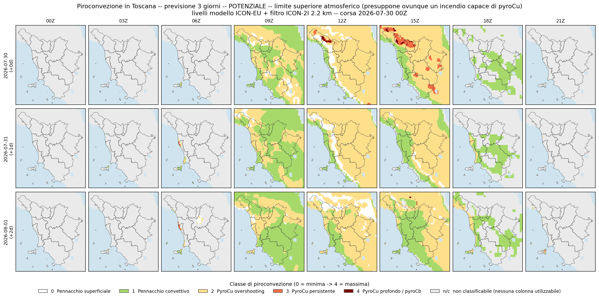
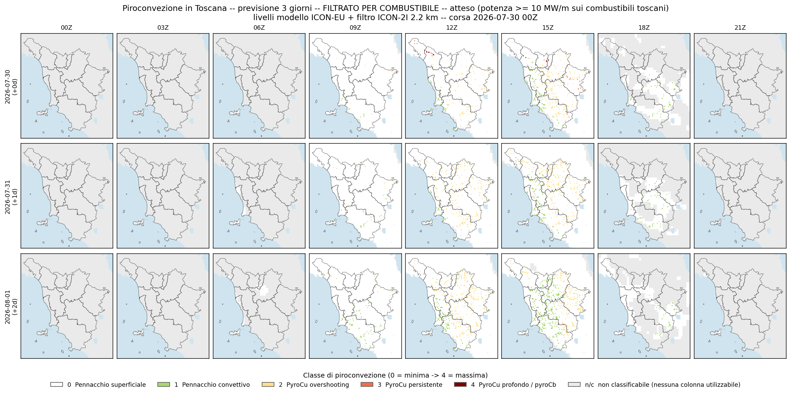
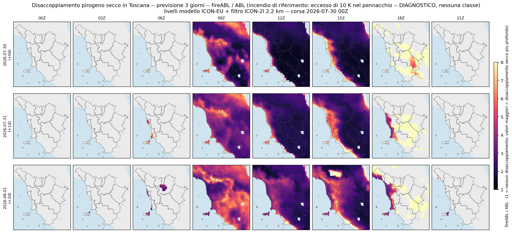

## Previsione a 3 giorni

Tre giorni validi dalla singola corsa 2026-07-30 00Z (giorno 0, +1, +2), usando gli step
previsionali a +1/+2 giorni degli stessi dataset ICON-EU + ICON-2I. Ogni giorno è un **ciclo
completo di 24 h, triorario, che inizia alle 00Z del giorno di corsa** (00Z, 03Z, 06Z, 09Z, 12Z, 15Z, 18Z, 21Z), sicché le tre
righe-giorno di ogni figura sono direttamente confrontabili e il giorno 0 si apre sull'istante
iniziale della corsa stessa. I pannelli coprono il dominio toscano con i confini provinciali
ISTAT; il mare è mascherato. Atmosfera dai livelli modello nativi ICON-EU (ABL da numero di
Richardson bulk, LCL di Bolton, dtheta/dz misurato nello strato rimescolato, gamma-theta del
tappo, umidità relativa alla sommità dell'ABL, shear); il filtro combustibile a 10 MW/m usa i
campi superficiali ICON-2I a 2,2 km sui combustibili .lcp toscani. Per la validazione
diagnostica (radiosondaggi + ERA5) si veda scripts/validation/README.md.

### Le tre domande a cui questo bollettino risponde

Ogni mappa risponde a una domanda. Vanno lette nell'ordine -- ma si veda l'avvertenza sotto la
domanda 3: le domande **non** sono annidate, e una cella puo superare la 3 fallendo la 2.

| # | Domanda | Mappa | Il criterio |
|:--|:--|:--|:--|
| 1 | Qual è la piroconvezione più intensa che questa **colonna** potrebbe sostenere? | POTENZIALE | la scala diagnostica, senza alcuna condizione sul fuoco |
| 2 | C'è abbastanza fuoco per generare un **pennacchio**? | FILTRATO PER COMBUSTIBILE | intensità di Byram >= 10 MW/m sui combustibili .lcp |
| 3 | C'è abbastanza fuoco per generare un **pyroCb** in questa specifica colonna? | MARGINE PFT | potenza totale >= PFT propria di quella colonna |

La domanda 1 è una proprietà della sola atmosfera: nessuna informazione sui combustibili o
sul suolo vi entra, nemmeno per stabilire dove sia definita. Le domande 2 e 3 condizionano
entrambe al fuoco e discendono entrambe dallo stesso campo di intensità di Byram, ma **non**
sono lo stesso criterio e non concordano: la (2) confronta la potenza *per metro di fronte*
con una costante fissa di 10 MW/m, mentre la (3) la converte in potenza *totale* attraverso una
lunghezza di fronte di testa assunta e la confronta con una soglia calcolata per quella colonna.
Le celle superano regolarmente la (2) e falliscono la (3) di ordini di grandezza. La domanda 3
è quella operativamente decisiva, ed è la più difficile da soddisfare.

Una quarta mappa, il **disaccoppiamento pirogeno secco**, supporta tutte e tre: è la
controparte secca della scala umida delle classi e non porta alcuna etichetta di classe. I
*conteggi* delle classi vanno letti come indicativi.

## 1. Potenziale -- che cosa potrebbe sostenere questa colonna? (limite superiore atmosferico)

{width=100%}

La scala diagnostica con la condizione sul fuoco completamente disattivata: questa è dunque la
risposta della sola atmosfera. È la piroconvezione più intensa che la colonna sosterrebbe **dato
un incendio in grado di sfruttarla**. Quell'incendio è presupposto, non calcolato: entra
attraverso le soglie calibrate della scala, non attraverso una mappa di combustibili. Questa
mappa serve a vedere dove sia l'atmosfera il vincolo stringente, mai come previsione. Si noti
che il classificatore gira su qualunque colonna utilizzabile, anche sul mare: nella figura il
mare è mascherato, ma i raster `pyroconv_potential_*.tif` sottostanti no, quindi ogni statistica
zonale ricavata direttamente da essi va limitata alla terraferma.

## 2. Filtrato per combustibile -- c'è abbastanza fuoco per un pennacchio?

{width=100%}

La stessa scala diagnostica, sulle stesse colonne, con ogni cella forzata alla classe 0 dove i
combustibili .lcp toscani e la meteorologia superficiale prevista non sostengono **10 MW/m** di
intensità del fronte secondo Byram (Tedim et al. 2018). Il filtro è binario e unidirezionale:
sopra la soglia i combustibili non hanno più alcuna influenza, sotto la soglia la cella riporta
un pennacchio superficiale qualunque cosa dica l'atmosfera. Questa mappa non può quindi mai
superare la mappa del potenziale -- ogni differenza fra le due è una cella riportata a 0 -- ed è
il prodotto operativo atteso.

## 3. Margine PFT -- c'è abbastanza fuoco per un pyroCb in *questa* colonna?

{width=100%}

Potenza **totale** dell'incendio per cella, divisa per la **PyroCb Firepower Threshold** propria
di quella colonna (Tory & Kepert 2021, eq. 31: `PFT = 0.3 z_fc^2 U_ML dtheta_fc`, in GW). Da 1
in su l'incendio è abbastanza potente da forzare un pyroCb *in quella colonna*; sotto 1 non lo
è, per quanto favorevole sia l'atmosfera. Il colore si imperna esattamente su 1 e la scala è
logaritmica, perché il campo si estende su quattro decadi.

L'intensità di Byram è una potenza per metro di fronte e la PFT è una potenza totale: per
collegarle serve una lunghezza attiva del fronte di testa. Anziché assumerne una, la si ricava
dal comportamento del fuoco pubblicato dal Wildfire Data Portal -- la mediana sui suoi 20
incendi che riportano sia il rapporto di superficie bruciata sia la velocità di avanzamento,
700 m -- con una frazione convettiva pari a 0.7 del calore rilasciato che entra nel
pennacchio (Tory & Kepert app. D). Sono entrambe assunzioni, e il margine scala linearmente con
ciascuna: un fronte di testa di 5 km, che Tory & Kepert indicano per un caso estremo,
moltiplicherebbe ogni margine qui riportato per circa sette. **Il margine va letto come un
ordine di grandezza, non come un numero.**

È questa la ragione per cui la mappa conserva valore nonostante l'avvertenza: sulla maggior
parte del dominio bruciabile il margine non è prossimo a 1, ma due o tre decadi al di sotto,
sicché la conclusione «qui nessun pyroCb» è robusta rispetto all'assunzione sul fronte di testa
in un modo in cui una cella marginale non lo sarebbe. Dove invece il margine si avvicina a 1,
l'assunzione diventa portante e la cella merita un giudizio, non la mappa.

Tre esclusioni sono disegnate in modo diverso, deliberatamente: il **grigio** è una colonna che
il classificatore ha rifiutato (nessuna atmosfera su cui applicare il criterio), il **bianco** è
suolo privo di combustibile bruciabile (potenza esattamente nulla: un no categorico, non un
margine piccolo), e il mare è mascherato. Il campo sottostante è `diag_pft_margin_*.tif`, con
numeratore e denominatore a fianco come `diag_firepower_gw_*.tif` e `diag_pft_gw_*.tif`.

### Le domande 2 e 3 non sono annidate -- si leggano i simboli, non il colore

Una cella può soddisfare il criterio PFT **fallendo** il filtro dei 10 MW/m, e in questa corsa
è quanto accade per la maggior parte di esse. Il meccanismo sta al denominatore: la PFT è
`0.3 z_fc^2 U_ML dtheta_fc`, sicché in una colonna bassa, debolmente tappata e con vento
leggero essa collassa -- a fronte di una mediana di dominio prossima a 90 GW, le celle con
margine >= 1 hanno PFT di pochi GW. Un incendio da 2-8 MW/m «supera» allora una soglia che un
incendio di quelle dimensioni non può fisicamente dirsi aver battuto, perché a quell'intensità
non c'è alcun pyroCu da approfondire.

La mappa distingue i due casi, e solo il primo è una previsione:

* **cerchio nero** -- margine >= 1 *e* filtro combustibile superato. Un autentico candidato pyroCb.
* **croce grigia** -- margine >= 1 ma filtro non superato. La PFT è degenerata, non è stata
  battuta. Vanno letti come un artefatto della forma della soglia a piccoli `z_fc`, non come
  un segnale.

La colonna **anche filtro superato** della tabella che segue è dunque il conteggio operativo.
Prendere invece il conteggio grezzo del margine sovrastimerebbe di parecchie volte l'area
candidata.

## Margine di potenza per pyroCb -- ore diurne, % del suolo bruciabile e classificabile

| Giorno | Ora | % griglia con potenza | % margine >= 1 | % margine >= 0,1 | margine max | celle >= 1 | **anche filtro superato** |
|:--|:--|--:|--:|--:|--:|--:|--:|
| 2026-07-30 | 09Z | 25.8 | 0.0 | 1.3 | 0.64 | 0 | **0** |
| 2026-07-30 | 12Z | 25.6 | 1.6 | 10.1 | 6.62 | 56 | **18** |
| 2026-07-30 | 15Z | 25.3 | 0.2 | 9.7 | 7.14 | 8 | **5** |
| 2026-07-30 | 18Z | 8.8 | 0.0 | 1.6 | 0.34 | 0 | **0** |
| 2026-07-31 | 09Z | 25.9 | 0.0 | 0.2 | 0.55 | 0 | **0** |
| 2026-07-31 | 12Z | 25.8 | 0.3 | 4.4 | 2.38 | 10 | **4** |
| 2026-07-31 | 15Z | 25.3 | 0.5 | 8.9 | 5.21 | 18 | **14** |
| 2026-07-31 | 18Z | 8.4 | 0.0 | 1.3 | 0.16 | 0 | **0** |
| 2026-08-01 | 09Z | 25.9 | 0.0 | 0.6 | 0.56 | 0 | **0** |
| 2026-08-01 | 12Z | 26.0 | 0.0 | 5.7 | 0.7 | 0 | **0** |
| 2026-08-01 | 15Z | 25.7 | 0.0 | 4.7 | 0.67 | 0 | **0** |
| 2026-08-01 | 18Z | 7.9 | 0.0 | 0.2 | 0.12 | 0 | **0** |

*% griglia con potenza* è la quota di dominio che ha insieme una colonna classificabile e
combustibile bruciabile; le due colonne del margine sono percentuali **di quella quota**, non
della Toscana. Una percentuale sull'intero dominio sarebbe dominata dalle celle prive di
combustibile, che non potranno mai contribuire, e si muoverebbe per ragioni estranee alla
previsione. *celle >= 1* è il conteggio grezzo dietro la prima percentuale, riportato perché a
questi tassi una percentuale si arrotonda a un valore che sembra nulla quando in realtà si
tratta di una manciata di luoghi precisi. ***anche filtro superato*** applica il criterio
congiunto della sezione precedente ed è il conteggio su cui agire; lo scarto fra esso e
*celle >= 1* è la popolazione a PFT degenerata.

## 4. Disaccoppiamento pirogeno secco -- DIAGNOSTICO (nessuna etichetta di classe)

{width=100%}

Il **rapporto di disaccoppiamento** fireABL / ABL indica quanto in alto un incendio intenso di
riferimento (un eccesso di temperatura di 10 K nel pennacchio, l'estremo intenso delle
misure in-plume GRAF, 0,1-13,1 K) accrescerebbe il proprio strato limite per *solo calore
sensibile*, diviso per l'ABL ambientale. È la controparte **secca** delle mappe umide delle
classi qui sopra (Castellnou et al. 2022; Castellnou Ribau et al. 2024): valori ben superiori a
1 segnalano colonne profonde, calde e secche, in cui un incendio può sfondare e disaccoppiarsi
dalla superficie *anche dove la scala umida assegna punteggi bassi* -- che è esattamente la
situazione che la mappa filtrata sottostima. Come la mappa del potenziale, presuppone un incendio
ovunque -- qui con un flusso di riferimento fisso anziché calcolato -- sicché è un limite
superiore, non una previsione; non si applica alcuna distinzione LCL secco/umido (lo scarto di
+1 km presente in letteratura non è supportato dalle etichette prototipo GRAF). fireABL da
`pyflam.atmosphere.fire_induced_abl_grid`, la particella intersecata con la reale colonna
theta(z); le celle che il classificatore rifiuta (nessuna colonna utilizzabile, o ABL sotto i
150 m) restano bianche anziché essere dipinte con un quoziente nudo.

## Disaccoppiamento secco -- ore diurne, % del suolo classificabile

| Giorno | Ora | % griglia classificabile | % area rapporto >= 2 | % area rapporto >= 3 | rapporto max |
|:--|:--|--:|--:|--:|--:|
| 2026-07-30 | 09Z | 80.9 | 85.3 | 52.5 | 12.2 |
| 2026-07-30 | 12Z | 69.3 | 30.4 | 6.1 | 11.7 |
| 2026-07-30 | 15Z | 68.0 | 52.6 | 14.5 | 11.5 |
| 2026-07-30 | 18Z | 19.9 | 100.0 | 100.0 | 21.6 |
| 2026-07-31 | 09Z | 81.0 | 100.0 | 77.1 | 11.2 |
| 2026-07-31 | 12Z | 72.0 | 59.9 | 13.7 | 10.8 |
| 2026-07-31 | 15Z | 67.8 | 65.6 | 26.0 | 17.6 |
| 2026-07-31 | 18Z | 18.9 | 100.0 | 100.0 | 25.6 |
| 2026-08-01 | 09Z | 89.4 | 100.0 | 86.8 | 10.5 |
| 2026-08-01 | 12Z | 87.7 | 88.6 | 44.1 | 11.0 |
| 2026-08-01 | 15Z | 87.0 | 83.8 | 55.2 | 15.8 |
| 2026-08-01 | 18Z | 34.7 | 100.0 | 79.1 | 24.0 |

*% griglia classificabile* è la quota di dominio con una colonna utilizzabile a quell'ora (ABL
sopra i 150 m); le due colonne del rapporto sono percentuali **di quella quota**, non della
Toscana. Il denominatore collassa verso il tramonto man mano che lo strato rimescolato decade,
sicché una riga delle 18Z può segnare 100% su una piccola area residua: va letta insieme alla
colonna del classificabile.

## Distribuzione delle classi filtrate per combustibile -- ore diurne, % delle celle di terra (13141 celle)

| Giorno | Ora | superficiale | convettivo | overshooting | persistente | profondo | n/c |
|:--|:--|--:|--:|--:|--:|--:|--:|
| 2026-07-30 | 09Z | 85.5 | 0.1 | 0.1 | 0.0 | 0.0 | 14.3 |
| 2026-07-30 | 12Z | 72.2 | 0.2 | 0.9 | 0.0 | 0.1 | 26.6 |
| 2026-07-30 | 15Z | 69.7 | 0.6 | 1.6 | 0.1 | 0.0 | 27.9 |
| 2026-07-30 | 18Z | 20.6 | 0.4 | 0.0 | 0.0 | 0.0 | 78.9 |
| 2026-07-31 | 09Z | 85.5 | 0.2 | 0.1 | 0.0 | 0.0 | 14.2 |
| 2026-07-31 | 12Z | 74.5 | 0.2 | 1.5 | 0.0 | 0.0 | 23.7 |
| 2026-07-31 | 15Z | 69.0 | 0.8 | 2.0 | 0.0 | 0.0 | 28.2 |
| 2026-07-31 | 18Z | 19.6 | 0.4 | 0.0 | 0.0 | 0.0 | 80.0 |
| 2026-08-01 | 09Z | 94.1 | 0.5 | 0.1 | 0.0 | 0.0 | 5.3 |
| 2026-08-01 | 12Z | 90.1 | 0.7 | 2.1 | 0.0 | 0.0 | 7.1 |
| 2026-08-01 | 15Z | 88.4 | 2.2 | 1.6 | 0.0 | 0.0 | 7.9 |
| 2026-08-01 | 18Z | 36.5 | 0.3 | 0.0 | 0.0 | 0.0 | 63.3 |

Classi: 0 pennacchio superficiale, 1 pennacchio convettivo, 2 pyroCu overshooting, 3 pyroCu
persistente, 4 pyroCu profondo/pyroCb. **n/c** è suolo privo di colonna classificabile (nessun
profilo utilizzabile, oppure ABL sotto i 150 m) -- cosa distinta dalla classe 0, che è invece
il responso della scala diagnostica: la colonna sostiene solo un pennacchio superficiale. Verso
il tramonto n/c occupa la maggior parte del dominio; quelle ore non portano previsione, e non
vanno lette come ore tranquille.

## Colonne serali e strato residuo

Dopo il tramonto lo strato convettivo collassa in un sottile strato stabile, ma l'aria
soprastante conserva il profilo quasi neutro della giornata: è lo **strato residuo**. Una
particella riferita alla superficie trova solo lo strato stabile, e un dtheta/dz di strato
rimescolato calcolato dentro quella profondità non ha livelli su cui lavorare, sicché l'intero
dominio finiva per cadere fra i non classificabili. Il gradiente viene ora calcolato sulla
maggiore fra la profondità della particella e quella dello strato residuo
(`atmosphere.residual_layer_grid`), che di giorno si riduce esattamente alla profondità della
particella e differisce solo di sera. **Questo cambia le classi serali**: quelle ore ora portano
una previsione dove prima non ne portavano alcuna. Vanno trattate con più cautela di quelle
centrali -- la diagnostica è più recente e la profondità residua che restituisce appare ancora
sottile rispetto a quanto suggerisce il profilo.

Due ulteriori diagnostiche viaggiano insieme e **non** sono usate dal classificatore: il salto
di zona di entrainment `delta_theta` (il gradino di temperatura potenziale che un pennacchio deve
superare per uscire dallo strato rimescolato) e `firecape` (Potter 2005, la CAPE di una
particella riscaldata dall'incendio). Entrambe provengono dall'insieme di variabili del metodo
originale; nessuna delle due filtra una classe qui, perché il criterio di penetrazione che
implicano non discrimina ancora alla potenza di incendio di riferimento di questo prodotto. Si
veda `docs/graf_vs_pyflam_2026-07-26.md`.

I GeoTIFF orari delle classi e delle diagnostiche accompagnano questo bollettino in
`rasters_hybrid_<giorno>/`: ABL, parcel_ml, residual_ml, LCL, LCL/ABL, dtheta/dz dello strato
rimescolato, gamma-theta del tappo, RH alla sommità, fireABL, decoupling, delta_theta, firecape,
penetration, oltre al lato fuoco -- fuel_load, burnable_fraction, firepower_gw, pft_gw,
pft_margin, crit_growth_ha_h, z_fc, u_ml, delta_theta_fc.
Generato da scripts/forecast_3day_tuscany.py con pyflam `894a4b9`, 2026-07-31 13:56 UTC.
Questo prodotto non è rigenerabile una volta che DWD ritira la corsa (~24 h), ed è quindi
congelato con la fisica di quel commit.
