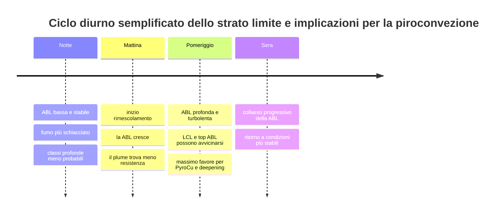
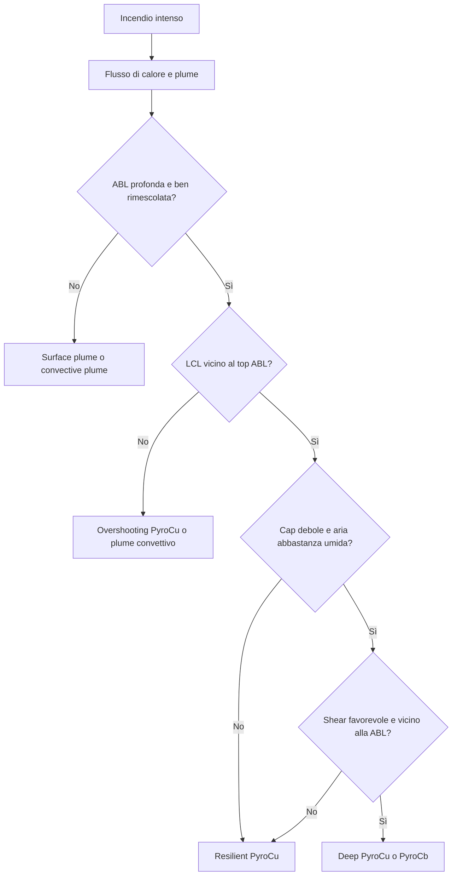
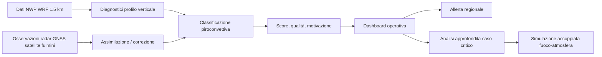

# Rapporto tecnico sulla predisposizione atmosferica alla piroconvezione con WRF 1.5 km

## Sintesi esecutiva

I documenti forniti delineano un impianto metodologico coerente e già sorprendentemente maturo per trasformare un quadro concettuale di ricerca sulla piroconvezione in un prodotto operativo: il paper di Castellnou et al. propone una classificazione fisicamente motivata dei regimi piroconvettivi a partire da profili verticali e osservazioni in-plume; lo script `pyroconvection_wrf15_v1_7_4.py` implementa una “ladder” adattiva su dati WRF a 1.5 km; il README spiega come interpretare il risultato con gli opportuni indici di qualità e motivazione. Il cuore dell’approccio è semplice da enunciare anche per non specialisti: la colonna atmosferica è tanto più favorevole a PyroCu profondi o PyroCb quanto più il top dello strato rimescolato, la quota di condensazione, l’umidità e la posizione dello shear risultano fra loro “allineati”, mentre una ABL troppo bassa, una copertura stabile sopra la ABL o una colonna troppo secca sfavoriscono il deepening verticale. fileciteturn5file0 fileciteturn5file12 fileciteturn4file5

Il principale punto di forza dei documenti è che non vendono il prodotto come “probabilità di PyroCb”, ma come **predisposizione atmosferica sotto forcing d’incendio intenso**. Questa distinzione è metodologicamente corretta: né ERA5 né WRF, da soli, contengono il forcing termico reale del fuoco, la continuità e disponibilità del combustibile, la dinamica del fronte di fiamma o il rilascio di calore latente indotto dalla nube piroconvettiva. Proprio per questo il README raccomanda di non leggere mai `pyro_class` da sola ma insieme a `classification_mode` e `classification_quality`, e il paper originale sottolinea che la classe finale dipende dall’interazione fra intensità del fuoco, stabilità della ABL, lapse rate in libera troposfera, quota di LCL e shear rispetto alla ABL. fileciteturn4file5 fileciteturn5file13

Dal punto di vista scientifico, l’impostazione è buona perché conserva il nesso con la fisica osservata: Castellnou et al. hanno costruito la classificazione su sette incendi estremi osservati con radiosondaggi in-plume e nell’ambiente, usando ABL height, LCL, altezza di massimo shear, gradienti di temperatura potenziale e misure di propagazione del fuoco; hanno inoltre mostrato che gli eventi di “moist convection” producono effetti molto più grandi sulla propagazione del fuoco rispetto ai regimi più secchi, con rapporti osservato/modellato della velocità di propagazione che arrivano fino a 34 e con una forte correlazione fra incremento del rate of spread e velocità verticale dell’updraft. fileciteturn5file5 fileciteturn5file3

Dal punto di vista operativo, lo script v1.7.4 aggiunge elementi preziosi di robustezza: usa i livelli originali per stimare shear e gradienti, evita di “inventare” massimi di shear a quote non risolte, gestisce in modo conservativo i casi in cui il crossing di Bulk Richardson non è abbastanza vincolato verticalmente, distingue fra ABL ricavata con Bulk Richardson, fallback su PBLH WRF e semplice upper bound poco profondo, e rende l’output auditabile con `classification_reason`, `classification_mode`, `classification_quality`, `abl_source` e indicatori di risoluzione dei diversi diagnostici. Inoltre riduce il carico di memoria elaborando un timestamp per volta e applicando il ritaglio spaziale e lo stride prima del merge dei dataset. fileciteturn3file2 fileciteturn5file18 fileciteturn5file15 fileciteturn5file16

I limiti principali sono altrettanto chiari. Primo: il sistema è **deterministico**, mentre il problema reale è fortemente aleatorio e sensibile a errori di inizializzazione, topografia, fuel moisture e sub-grid processes. Secondo: le soglie sono esplicitamente “paper-informed” e prototipali, quindi non ancora calibrate per Toscana e Mediterraneo. Terzo: l’assenza di un modulo esplicito di assimilazione di osservazioni locali e di una vera validazione statistica su casi storici limita la trasferibilità operativa. Quarto: la classificazione incorpora solo indirettamente concetti più familiari ai previsori convettivi, come CAPE, CIN o shear integrato 0–6 km; questo è difendibile fisicamente, ma rende più difficile il dialogo con la prassi meteo-operativa standard. Quinto: nel file v1.7.4 appare ancora l’attributo `software_version = "pyroconvection_wrf15_v1_7_3"`, dettaglio piccolo ma rilevante per la tracciabilità. fileciteturn4file5 fileciteturn3file1

Le raccomandazioni più importanti sono quindi cinque. La prima è **validare e calibrare** il sistema su una casistica locale strutturata. La seconda è **estendere gli input osservativi** con radiosondaggi, radar, GNSS-PWV, satelliti e, quando possibile, osservazioni in-plume o proxy del plume-rise. La terza è **aggiungere una modalità ensemble/multimodello** e non affidarsi a un solo run WRF deterministico. La quarta è **affiancare** alla classificazione prototipale alcuni diagnostici convettivi standard, non per sostituirla ma per contestualizzarla. La quinta è distinguere due livelli operativi: uno “screening” regionale e rapido con la classificazione corrente, e uno “nowcasting avanzato” per le aree più critiche con assimilazione osservativa e, per i casi più estremi, modellistica accoppiata fuoco–atmosfera. Queste raccomandazioni sono coerenti sia con la documentazione WRF/WRFDA sia con la letteratura recente su assimilazione radar in Italia, archivio radar nazionale e modelli accoppiati WRF-Fire/SFIRE. citeturn18view0turn18view2turn6academia1turn30academia0turn7academia1turn7academia0

## Documenti analizzati e impianto metodologico

La base documentale effettivamente disponibile comprende tre elementi principali: il paper **“Pyroconvection Classification based on Atmospheric …”** di Castellnou et al.; lo script **`pyroconvection_wrf15_v1_7_4.py`**; e il README operativo **`README_pyroconvection_wrf15_v1_7_COMPLETO.md`**. Nel complesso, questi materiali costruiscono una catena logica che va dalla fisica osservata della piroconvezione alla sua traduzione in un diagnostico operativo su griglia WRF. fileciteturn5file0 fileciteturn4file14 fileciteturn4file5

| Documento | Ruolo nel sistema | Informazione chiave per questo rapporto |
|---|---|---|
| Paper di Castellnou et al. | Base fisica e osservativa | La classificazione distingue plume convettivi, overshooting PyroCu, resilient PyroCu e deep PyroCu/PyroCb usando stabilità ABL, rapporto LCL/ABL, posizione dello shear e risposta del fuoco osservata/modellata. fileciteturn5file0 fileciteturn5file12 |
| `pyroconvection_wrf15_v1_7_4.py` | Implementazione operativa | Traduce il quadro del paper in una classificazione adattiva con classi, qualità, motivo dominante, sorgente ABL e diagnostici di risoluzione. fileciteturn3file5 fileciteturn3file13 |
| README operativo | Regole d’uso e interpretazione | Spiega che la classe 4 non implica formazione certa di PyroCb, raccomanda di usare sempre `pyro_class + classification_mode + classification_quality`, e dichiara la natura prototipale da validare su casi locali. fileciteturn4file5 |

Il WRF documentato nel README è un dataset operativo deterministico a 1.5 km, con run 00 e 12 UTC e orizzonte fino a +72 h; l’elaborazione usa campi di superficie e livelli isobarici, e lo script ricostruisce il profilo verticale fino a circa 8–9 km usando i livelli fra 1000 e 300 hPa e i campi principali `gh, t, q, r, u, v`, oltre a variabili di superficie come temperatura, dew point, vento, PBLH, orografia e pressione al livello del mare. Questo colloca il prodotto in una fascia molto utile per lo screening mesoscala, ma ancora distinta dalla modellistica esplicitamente accoppiata fuoco–atmosfera. fileciteturn4file14 fileciteturn4file12 fileciteturn5file10

Il modello WRF, nel sito ufficiale NCAR, è descritto come un sistema atmosferico di stato dell’arte per ricerca e previsione numerica, utilizzabile da scale di decine di metri a migliaia di chilometri e dotato anche di capacità di data assimilation; il sito WRFDA chiarisce inoltre che il sistema di assimilazione è pensato per un ampio spettro di applicazioni, dal mesoscala al globale. Questo rende metodologicamente naturale proporre, in prospettiva, un’estensione del sistema verso assimilazione e multimodello invece di fermarsi alla sola classificazione deterministica. citeturn18view2turn18view0

Sul fronte delle reanalisi, il paper di Castellnou usa ERA5 come riferimento modellistico e ne riconosce apertamente i limiti nel risolvere topografia ripida ed eterogeneità di superficie; la documentazione Copernicus conferma che ERA5 fornisce dati orari su molti parametri a 0.25° e 37 livelli di pressione, quindi è eccellente per il contesto sinottico e meso-alfa, ma non per i dettagli locali più fini. Copernicus mette inoltre a disposizione CERRA a 5.5 km sull’Europa, una fonte potenzialmente interessante per confronti o downscaling, pur rimanendo meno risolutiva del WRF 1.5 km usato nei documenti. fileciteturn5file0 citeturn17view0

## Le basi fisiche spiegate in modo intuitivo

### Pressione, temperatura, umidità e vento

La **pressione atmosferica** è, in termini intuitivi, il “peso” della colonna d’aria sovrastante su una certa area. In termini fisici è una forza per unità di area esercitata dagli urti molecolari; in meteorologia, quando diciamo semplicemente “pressione”, intendiamo quasi sempre pressione atmosferica. Per un non specialista, può essere utile immaginarla come la massa d’aria che preme dall’alto: dove la colonna è più pesante la pressione tende a essere più alta, e i gradienti di pressione contribuiscono a mettere in moto il vento. citeturn25view1turn27view3

La **temperatura** è la misura dell’energia cinetica media delle molecole. In termini operativi, aria più calda tende a essere meno densa e quindi, a parità di tutto il resto, più incline a salire; aria più fredda tende a essere più densa e quindi più incline a restare nei bassi strati o a scorrere sotto l’aria calda. Questa differenza di densità è uno dei motori fondamentali della convezione e dei fronti. citeturn26view2turn24view2

L’**umidità relativa** dice quanto il “serbatoio” di vapore nell’aria sia vicino alla saturazione alla temperatura e pressione date. Un’analogia utile è quella della spugna: aria fredda è una spugna più piccola, aria calda una spugna più grande. Se la spugna si riempie fino al limite, il vapore in eccesso condensa in goccioline o cristalli. Per questo il raffreddamento adiabatico durante la risalita dell’aria è così importante per nubi e precipitazioni. citeturn25view0turn24view1

Il **vento** è aria in movimento rispetto alla superficie terrestre. Nei bassi strati consideriamo soprattutto la componente orizzontale, misurata con anemometro e banderuola; in quota il vento si ricava, per esempio, con radiosondaggi. Per chi lavora sugli incendi, il vento è cruciale in due sensi: guida direttamente il fronte di fiamma e, in quota, condiziona la forma e l’organizzazione del plume. citeturn25view2turn5file5

### Stabilità atmosferica, ABL e lapse rates

La **stabilità atmosferica** descrive quanto l’aria “resista” o “favorisca” uno spostamento verticale. Se una bolla d’aria sollevata risulta più calda e leggera dell’ambiente, tende a continuare a salire: l’atmosfera è instabile o poco stabile. Se invece, salendo, la bolla diventa più fredda e pesante dell’aria attorno, torna giù: l’atmosfera è stabile. In pratica, stabilità e instabilità sono il freno o l’acceleratore dei moti verticali. citeturn26view1turn27view3

Il **lapse rate** è la variazione della temperatura con la quota, di solito la sua diminuzione salendo. Un modo semplice per pensarlo è questo: la temperatura dell’ambiente con la quota può calare lentamente o rapidamente; se cala molto rapidamente, una bolla che sale resta relativamente più calda dell’ambiente e quindi sale più facilmente. Se la temperatura ambientale cala poco, la bolla perde presto il suo vantaggio di galleggiamento. Nei documenti forniti, la stabilità è trattata soprattutto tramite gradienti di temperatura potenziale nella ABL e sopra la ABL, cioè con grandezze più robuste per analizzare il mescolamento e il “cap” libero-troposferico. citeturn26view0turn5file0turn4file4

La **ABL** o strato limite atmosferico è lo strato basso della troposfera direttamente a contatto con il suolo. È qui che il riscaldamento del terreno, l’attrito, la rugosità, la vegetazione e l’orografia rimescolano l’aria durante il giorno. In giornate soleggiate la ABL tende a crescere e a diventare più turbolenta; di notte in genere si abbassa e si stabilizza. Per la piroconvezione questo è decisivo: una ABL profonda e ben rimescolata fornisce una “pedana di lancio” molto più favorevole al plume rispetto a una ABL notturna sottile e stabile. citeturn26view3turn4file4

**Figura.** Schema qualitativo del ciclo diurno della ABL: non è una regola assoluta, ma rappresenta bene perché il solo valore istantaneo di temperatura non basta e serva leggere il profilo verticale e il grado di rimescolamento. La documentazione dei file caricati traduce questa logica imponendo soglie sulla profondità/classificabilità della ABL e una gestione conservativa dei casi con ABL poco profonda. citeturn26view3turn26view1turn4file4

### Advezione, fronti e processi di precipitazione

L’**advezione** è il trasporto di una proprietà atmosferica da parte del moto dell’aria. Per esempio, quando un vento da ovest porta aria più fresca o più umida su una regione, sta avvenendo advezione di temperatura o umidità. Per un non esperto si può immaginare un “nastro trasportatore” che sposta masse d’aria con caratteristiche diverse. Questo conta molto perché una stessa area può diventare favorevole o sfavorevole alla convezione senza modifiche locali del suolo, semplicemente perché cambia l’aria in arrivo. citeturn23view0

Un **fronte** è la zona di transizione fra due masse d’aria di densità diversa, quasi sempre anche di temperatura diversa. Con i fronti servono due idee semplici: il fronte caldo tende a far scorrere aria calda sopra aria più fredda dando precipitazioni più estese e stratiformi; il fronte freddo tende a sollevare più bruscamente l’aria calda e può produrre rovesci e temporali più intensi. In contesto d’incendio, il passaggio frontale conta sia perché cambia vento e umidità, sia perché può avvicinare shear e sollevamento organizzato alle aree incendiate. citeturn24view2

La **precipitazione** è l’insieme degli idrometeori abbastanza grandi da cadere per gravità. Nelle nubi calde domina il meccanismo di collisione e coalescenza: gocce che si scontrano e si fondono in gocce sempre più grandi finché cadono. Nelle nubi miste o fredde domina spesso il processo di Bergeron–Findeisen: i cristalli di ghiaccio crescono a spese delle goccioline sopraffuse perché la pressione di vapore di equilibrio sul ghiaccio è più bassa di quella sull’acqua liquida alla stessa temperatura. È importante perché un PyroCb non è “solo fumo che sale”: quando entrano in gioco condensazione, ghiaccio e calore latente, la dinamica cambia radicalmente. citeturn27view0turn33view0turn33view1turn27view2turn33view2

### CAPE, CIN, shear e il loro rapporto con i documenti forniti

La **CAPE** è l’energia potenziale disponibile per la convezione: in modo intuitivo, è l’“acceleratore” verticale di una particella d’aria che, una volta libera di salire, rimane più calda e quindi più leggera dell’ambiente. La **CIN** è il contrario: il “freno” energetico che impedisce alla particella di raggiungere il livello da cui diventerebbe liberamente convettiva. Nei diagrammi termodinamici sono le aree positiva e negativa tra la curva del parcel e il profilo ambientale. Per un non specialista: CAPE alta vuol dire che, se il motore si accende, il motore può spingere forte; CIN alta vuol dire che il motore fa fatica a partire. citeturn23view2turn24view0

Lo **shear del vento** è la variazione del vettore vento con la distanza, soprattutto con la quota. In meteorologia convettiva classica, lo shear aiuta a organizzare e mantenere strutture profonde; nella piroconvezione, il paper di Castellnou mette in evidenza non solo l’intensità dello shear ma soprattutto la **vicinanza del massimo shear al top della ABL** come elemento discriminante nelle transizioni di regime. È un punto molto importante, perché mostra che il sistema documentale non sta ignorando i parametri convettivi standard, ma li sta reinterpretando in una geometria specifica del plume da incendio. citeturn25view3turn5file0turn5file12

Qui sta una differenza sostanziale fra meteorologia convettiva “generica” e diagnostica piroconvettiva dei documenti forniti. Nei documenti, CAPE e CIN non sono il fulcro dell’algoritmo; il fulcro è una combinazione più “plume-aware” di profondità/rimescolamento della ABL, quota di condensazione, cap in libera troposfera, umidità al top della ABL e prossimità dello shear. Questa scelta è difendibile perché il paper sottolinea anche la difficoltà di stimare correttamente il fireCAPE, mentre invece l’updraft verticale e le grandezze geometriche del plume risultano più direttamente collegate agli effetti osservati sul fuoco. fileciteturn5file8 fileciteturn4file5

| Variabile | Spiegazione intuitiva | Unità tipica | Perché conta per la piroconvezione | Come entra nei documenti |
|---|---|---:|---|---|
| Pressione | Peso della colonna d’aria | hPa | Organizza il campo di vento e la struttura sinottica | Contesto, non variabile discriminante diretta. citeturn25view1turn25view2 |
| Temperatura | “Agitazione” molecolare | °C o K | Modifica densità e galleggiamento del plume | Usata tramite θ e gradienti verticali. citeturn26view2turn5file0 |
| Umidità relativa | Quanto l’aria è vicina alla saturazione | % | Controlla la facilità di condensazione e il rilascio di calore latente | RH al top ABL è un diagnostico esplicito. citeturn25view0turn3file1 |
| Vento | Movimento orizzontale dell’aria | m/s | Influenza spread, inclinazione del plume, ventilazione | Input diretto; lo shear è diagnostico chiave. citeturn25view2turn25view3 |
| Stabilità | Resistenza ai moti verticali | qualitativa o K/m | Decide se il plume viene schiacciato o approfondisce | θ-gradient ABL e cap libero-troposferico. citeturn26view1turn4file4 |
| Lapse rate | Come cambia T con la quota | K/km o K/m | Determina il favore ai moti verticali | Rappresentato in modo mirato da gradienti di θ. citeturn26view0turn5file0 |
| LCL | Quota in cui l’aria sollevata satura | m | Se è vicina al top ABL, la nube si forma più facilmente | Rapporto LCL/ABL centrale nella classificazione. citeturn24view1turn5file0 |
| CAPE | Acceleratore convettivo | J/kg | Misura energia disponibile | Non è esplicita nello script WRF fornito. citeturn23view2 |
| CIN | Freno convettivo | J/kg | Misura l’energia da superare per partire | Non è esplicita nello script WRF fornito. citeturn24view0 |
| Wind shear | Variazione del vento con la quota | s⁻¹ o m/s per km | Organizza plume e deepening | Altezza del massimo shear e sua vicinanza alla ABL. citeturn25view3turn5file0 |

## Cosa dicono i documenti sulla piroconvezione

Il paper di Castellnou et al. parte da un’idea molto concreta: classificare la piroconvezione non dal solo aspetto della nube, ma dal modo in cui il plume interagisce con lo strato limite e con la libera troposfera. Gli autori usano radiosondaggi lanciati **dentro il plume** e nell’ambiente circostante, confrontano profili verticali di temperatura, umidità e vento, e integrano questi dati con ERA5 e con informazioni di comportamento del fuoco. La classificazione deriva da stabilità della ABL, caratteristiche del plume, stadio del plume e posizione della turbolenza rispetto al top della ABL. fileciteturn5file5 fileciteturn5file0

Un risultato molto importante del paper è che la distinzione operativa non è semplicemente “c’è o non c’è nube”, ma “c’è o non c’è **regime secco** o **regime umido** indotto dal plume”. I plume convettivi e gli overshooting PyroCu vengono trattati come forme di dry convection, mentre resilient PyroCu e deep PyroCu/PyroCb appartengono al moist regime. Gli autori mostrano che il plume overshooting può aumentare l’entrainment discendente dalla zona di pyrocloud verso lo strato sub-cloud e che questo processo, a seconda del contenuto di umidità e della struttura verticale, può alimentare un regime molto più efficace nel modificare il rate of spread del fuoco. fileciteturn5file12 fileciteturn5file3

La classificazione proposta nel paper è stata poi tradotta nello script WRF in cinque classi nominali: **Surface plume**, **Convective plumes**, **Overshooting PyroCu**, **Resilient PyroCu** e **PyroCb**. Lo script associa inoltre a ogni cella un `classification_reason`, così da rendere esplicito il motivo dominante della classe finale, e un `classification_mode` che distingue i casi in cui la classificazione è completa da quelli in cui alcuni diagnostici non sono risolti e si ricorre a proxy o upper bounds conservativi. Questa è una scelta eccellente dal punto di vista operativo perché rende il prodotto verificabile e discutibile, invece di proporre una “mappa magica” non spiegata. fileciteturn3file10 fileciteturn3file13

Nella versione adattiva dello script, le soglie operative iniziali restano chiaramente ancorate al quadro concettuale del paper: gradiente ABL stabile intorno a \(10^{-3}\) K m\(^{-1}\), overshooting ammesso fino a \(3 \times 10^{-3}\) K m\(^{-1}\), cap debole attorno a \(4.2 \times 10^{-3}\) K m\(^{-1}\), rapporto LCL/ABL favorevole al deepening fino a circa 1.10, shear-distance ratio profondamente favorevole entro 0.30, RH media vicino al top della ABL attorno o sopra l’80%, e soprattutto una logica prudente secondo cui, sotto ABL poco profonde, la colonna deve restare in **Surface plume** anziché essere promossa artificialmente a plume convettivo. Lo script richiede inoltre un numero minimo di livelli originali per stimare gradiente ABL, cap e shear. fileciteturn4file4

**Figura.** Sintesi concettuale della classificazione usata dai documenti: la transizione verso classi profonde non dipende da un solo “indice”, ma dall’allineamento tra ABL, LCL, cap, umidità e shear sotto forcing d’incendio intenso. Il paper originale e lo script operativo convergono su questa logica. fileciteturn5file0 fileciteturn3file2 fileciteturn4file4

C’è anche un passaggio metodologico molto importante: il paper riconosce che ERA5 non risolve bene i dettagli legati a topografia ripida e eterogeneità sub-grid, e suggerisce che modelli a risoluzione più alta, come AROME o WRF, sarebbero una naturale evoluzione. Lo script WRF va esattamente in questa direzione, e quindi può essere letto non come una deviazione dal paper ma come la sua evoluzione operativa più naturale. fileciteturn5file0

## Valutazione critica dei documenti

### Punti di forza

Il primo grande punto di forza è la **coerenza fisica**. Molti prodotti operativi sugli incendi si limitano a combinare vento, temperatura e umidità con indici sintetici; qui invece la struttura verticale della colonna atmosferica è centrale. Questa scelta è giustificata dal paper, che mostra come le differenze decisive emergano proprio nel rapporto tra plume, ABL, LCL e shear, e come i regimi umidi producano le maggiori anomalie di comportamento del fuoco. fileciteturn5file12 fileciteturn5file3

Il secondo punto di forza è la **trasparenza dell’output**. La presenza di `classification_mode`, `classification_quality`, `classification_reason`, `abl_source`, `abl_upper_bound`, `rib_crossing_resolved`, `cap_resolved`, `rh_top_resolved` e `shear_resolved` evita di confondere l’assenza di informazione con una vera valutazione fisica. Per applicazioni di protezione civile e sale operative, questa auditabilità è più importante di qualche punto percentuale di “accuratezza apparente”, perché consente di capire se il segnale è robusto o fragile. fileciteturn3file9 fileciteturn5file18

Il terzo punto di forza è la **prudenza algoritmica**. Lo script non promuove automaticamente classi profonde quando la ABL è troppo bassa, non sostituisce indiscriminatamente l’informazione mancante con interpolazioni aggressive, usa lo shear solo quando risolto sui livelli originali e tratta `abl_upper_bound` come vincolo conservativo e non come stima diretta della profondità della ABL. Questo approccio riduce il rischio di falsi allarmi “spettacolari” nelle ore notturne o nei profili mal campionati. fileciteturn3file2 fileciteturn4file5 fileciteturn5file17

Il quarto punto di forza è l’**attenzione operativa**. Il README non nasconde che il prodotto è prototipale, che le classi 2–4 esprimono predisposizione e non probabilità, e che la comparazione tra esecuzioni richiede coerenza di livelli, dominio, stride, versione e soglie. Inoltre, la versione recente ottimizza memoria e I/O elaborando un timestamp per volta e ritagliando i dati a monte del merge. Questo è esattamente il tipo di maturità ingegneristica che distingue un test di ricerca da uno strumento integrabile in flussi di lavoro reali. fileciteturn4file5 fileciteturn5file15 fileciteturn5file16

### Debolezze e fonti di incertezza

La debolezza principale è che il sistema resta, per sua stessa ammissione, **prototipale e non calibrato localmente**. Le soglie sono “paper-informed”, quindi ragionevoli, ma non universalmente valide. Il README indica esplicitamente la necessità di confrontare il sistema con radiosondaggi, livelli nativi modellistici, casi storici positivi e negativi, sensitività delle soglie e valutazione separata delle celle con ABL da Bulk Richardson e da fallback PBLH. Senza questa fase, il rischio non è tanto “sbagliare la fisica”, quanto produrre un prodotto non ancora stabilizzato statisticamente sul dominio toscano-mediterraneo. fileciteturn4file5

La seconda debolezza è l’**assenza del forcing esplicito del fuoco**. Il sistema valuta la predisposizione atmosferica, ma non la potenza reale dell’incendio, il fuel load, la fuel moisture, la continuità del combustibile, l’intensità lineare di fiamma o la dinamica del perimetro. Il paper stesso mostra che gli effetti più forti emergono nella vera interazione fuoco–atmosfera, e la letteratura su WRF-Fire/SFIRE sottolinea che i modelli accoppiati fanno entrare nel sistema il flusso di calore dell’incendio che modifica a sua volta il vento e il plume. In altre parole, il sistema corrente è ottimo per dire “l’atmosfera oggi è predisposta”, ma non basta da solo per dire “qui e ora si formerà un PyroCb”. fileciteturn4file5 fileciteturn5file12 citeturn7academia1

La terza debolezza è la scelta di non usare esplicitamente **CAPE, CIN, DCAPE, LI, K-index o shear standardizzato 0–1 / 0–6 km**. Questa scelta ha una sua logica fisica nel contesto piroconvettivo, ma limita la confrontabilità con la meteorologia convettiva operativa tradizionale. A mio giudizio, questo non è un errore, però è una debolezza di integrazione interdisciplinare: chi lavora in previsione temporalesca tende a ragionare per ingredienti convettivi standard, e senza un pannello di confronto il dialogo fra analista incendi e previsore atmosferico può risultare meno immediato. citeturn23view2turn24view0turn25view3

La quarta debolezza è che la catena dipende molto dalla **risoluzione verticale utile** del profilo. I documenti sono consapevoli di questo limite e introducono requisiti minimi di piccoli numeri di livelli e gap verticali massimi, ma il problema resta: se il profilo non risolve bene il cap, la RH al top ABL o la posizione del massimo shear, parte della classificazione scivola in modalità `noshear` o in qualità bassa. Questo è metodologicamente onesto, ma operativamente significa che il colore in mappa non basta mai. fileciteturn4file4 fileciteturn4file5

La quinta debolezza è più sottile ma importante: anche reanalisi e modelli ad alta risoluzione possono **sottostimare le code estreme della CAPE** e delle condizioni più impattanti. Una valutazione climatologica recente ha mostrato che ERA5 e un WRF a 4 km possono sottorappresentare il “high tail” della CAPE, soprattutto per i casi più estremi, con implicazioni dirette proprio per l’identificazione delle condizioni più pericolose. Questo rafforza l’idea che i diagnostici del sistema corrente non debbano essere interpretati in modo assoluto ma in modo relativo, contestuale e, ove possibile, confrontati con osservazioni locali. citeturn21academia7

Infine, esiste un piccolo ma reale problema di **reproducibilità software**: nel frammento del v1.7.4 compare ancora l’attributo `software_version` impostato a `"pyroconvection_wrf15_v1_7_3"`. È un dettaglio minore per la fisica, ma non minore per audit trail, catena di custodia del prodotto e comparazione temporale fra release. In contesti operativi questo tipo di incongruenza va corretto subito. fileciteturn3file1

| Aspetto | Valutazione | Commento sintetico |
|---|---|---|
| Coerenza fisica | Molto buona | Forte aderenza al paper osservativo e alla geometria plume–ABL–LCL–shear. fileciteturn5file0 |
| Trasparenza diagnostica | Eccellente | Audit fields molto utili per le sale operative. fileciteturn3file9 |
| Robustezza operativa | Buona | Gestione prudente di ABL poco profonda e diagnostici irrisolti. fileciteturn5file17 |
| Uso osservazioni locali | Insufficiente | Mancano assimilazione e validazione su rete locale strutturata. fileciteturn4file5 citeturn18view0turn6academia1 |
| Quantificazione dell’incertezza | Debole | Prodotto deterministico, non ensemble e non probabilistico. fileciteturn4file5 |
| Accoppiamento fuoco–atmosfera | Assente nel prodotto corrente | Da considerare per i casi ad alto impatto. citeturn7academia1turn7academia0 |

## Miglioramenti metodologici, osservativi, modellistici e di visualizzazione

La prima linea di miglioramento è la **validazione retrospettiva strutturata**. I documenti stessi la invocano, e dovrebbe diventare la priorità assoluta. In pratica, serve costruire un archivio eventi con casi positivi e negativi in Toscana e aree mediterranee affini, abbinando per ogni evento: classe piroconvettiva osservata o assente, plume height osservato, presenza o meno di PyroCu/PyroCb, lightning, radar, satellite e caratteristiche dell’incendio. La classificazione corrente va poi verificata con metriche categoriali e probabilistiche adatte, trattando separatamente le modalità `full`, `resolved_noshear`, `proxy_noshear` e `shallow_abl_upper_bound`. Il README insiste giustamente su questo punto: un aumento della classe media dovuto a più celle `proxy_noshear` non equivale a un aumento ottenuto in modalità `full`. fileciteturn4file5

La seconda linea è l’**arricchimento osservativo** mediante assimilazione dati. Il sistema WRFDA ufficiale esiste proprio per integrare osservazioni e stato modellistico; lavori recenti su eventi italiani mostrano che l’assimilazione di radar e stazioni locali in WRF ha migliorato la previsione quantitativa di precipitazione grazie a una migliore descrizione del flusso basso e del contenuto di vapore. Per uno strumento di predisposizione alla piroconvezione questo è cruciale, perché LCL, umidità al top ABL e struttura del vento basso sono grandezze altamente sensibili alla qualità dell’analisi iniziale. citeturn18view0turn6academia1

La terza linea è l’**uso di osservazioni multi-sorgente ad alta frequenza** per il nowcasting. Oggi l’Italia dispone anche di un archivio cloud-optimized di precipitazione radar nazionale a 1 km e 5–15 minuti, utile non solo per precipitazione ma come base per verifiche, climatologie d’evento e sviluppo di proxy sugli ambienti convettivi estremi. A questo andrebbero aggiunti satelliti geostazionari, rilevazioni di fulmini, GNSS-PWV, webcam e, quando possibile, profilers o lidar. Il paper di Castellnou mostra con chiarezza il valore scientifico dei sondaggi in-plume: non saranno routine ovunque, ma costituiscono il benchmark ideale per tarare la lettura dei profili modellistici. citeturn30academia0 fileciteturn5file5

La quarta linea è l’**evoluzione da deterministico a ensemble/multimodello**. In Italia, i reforecast convection-permitting hanno mostrato valore aggiunto rispetto ai sistemi globali, pur mantenendo difficoltà nel riprodurre alcuni picchi; questo è esattamente il tipo di lezione che va traslato alla piroconvezione. Non serve necessariamente costruire subito un grande ensemble dedicato; si può iniziare con confronto WRF–ICON–CERRA/ERA5 o con perturbazioni di soglie e inizializzazioni per approssimare l’incertezza. Anche i file caricati mostrano che esistono già derivazioni ERA5 e ICON della stessa logica classificativa. citeturn30academia2turn17view0 fileciteturn5file7 fileciteturn5file2

La quinta linea è l’**integrazione di diagnostici convettivi standard** come pannello di contesto, non come sostituti. Aggiungere SBCAPE, MUCAPE, CIN, DCAPE, K-index, 0–1 km shear, 0–6 km shear, LFC ed EL aiuterebbe moltissimo l’interpretazione sinottico-convettiva da parte dei meteorologi operativi. Il punto chiave, però, è non confondere questi indici con la dinamica specifica del plume da incendio: devono essere letti come “contesto atmosferico generale”, mentre la classificazione paper-based resta il “nucleo plume-aware”. citeturn23view2turn24view0turn25view3

La sesta linea è il passaggio, per i casi più critici, verso **modellistica accoppiata fuoco–atmosfera**. La letteratura WRF-Fire/SFIRE mostra che il modello di incendio usa il vento superficiale come input e restituisce flussi di calore all’atmosfera, generando un’accoppiamento bidirezionale che è precisamente ciò che manca al sistema corrente. Sono state sviluppate anche tecniche di assimilazione di perimetri e fuel moisture. La mia raccomandazione non è sostituire il prodotto attuale con un accoppiato completo in operatività ordinaria, ma istituire un secondo livello specialistico per giornate ad altissimo rischio o grandi eventi in corso. citeturn7academia1turn7academia0turn3academia7

La settima linea è la **visualizzazione**. Il prodotto corrente ha già un buon impianto cartografico, ma può essere migliorato in leggibilità decisionale. Per esempio: mappe bivariate o a semaforo che combinino classe e qualità; pannelli temporali per l’evoluzione di ABL, LCL/ABL, RH-top e shear-distance; allarmi solo quando una soglia resta persistente per più scadenze; filtri territoriali per province/AIB; e schede locali che mostrino il “perché” di ogni pixel critico. Questo riduce moltissimo il rischio di sovrainterpretazione del colore puro. fileciteturn3file11 fileciteturn4file5

**Figura.** Flusso di lavoro raccomandato: mantenere lo screening rapido del prodotto attuale, ma aggiungere ingestione osservativa, qualità dell’informazione e una seconda corsia specialistica per i casi ad alto impatto. La proposta è coerente con WRFDA, con i risultati di assimilazione radar in Italia e con la letteratura sui modelli accoppiati. citeturn18view0turn6academia1turn7academia1

| Area di miglioramento | Proposta concreta | Beneficio atteso | Supporto documentale |
|---|---|---|---|
| Validazione | Archivio di casi locali positivi/negativi e verifica separata per `full`, `noshear`, `fallback` | Calibrazione reale e riduzione dei falsi segnali | README: soglie prototipali e necessità di validazione. fileciteturn4file5 |
| Osservazioni | Integrare radar, GNSS-PWV, lightning, satellite, stazioni e profili verticali | Migliore analisi iniziale di umidità, ABL e vento | WRFDA + studio di assimilazione radar in Italia. citeturn18view0turn6academia1 |
| Dati di verifica | Usare archivio radar nazionale cloud-optimized | Verifica ad alta risoluzione spazio-temporale | IT-DPC-SRI. citeturn30academia0 |
| Modellistica | Ensemble o multimodello con WRF/ICON/CERRA | Quantificazione dell’incertezza | Reforecast convection-permitting in Italia + CERRA Copernicus. citeturn30academia2turn17view0 |
| Fisica convettiva | Affiancare CAPE, CIN, LFC, EL, DCAPE, shear standard | Miglior dialogo fra previsione convettiva e piroconvettiva | AMS Glossary + interpretazione del sistema attuale. citeturn23view2turn24view0turn25view3 |
| Fuoco–atmosfera | Livello avanzato con WRF-Fire/SFIRE e assimilazione di perimetro/fuel moisture | Maggiore realismo nei grandi eventi | WRF-Fire e assimilazione fuel/perimeter. citeturn7academia1turn7academia0turn3academia7 |
| Visualizzazione | Mappe classe×qualità, time-series pixel-based, cause dominanti | Migliore leggibilità per non esperti e decisori | Script e README già predisposti a qualità e reason. fileciteturn3file9 fileciteturn4file5 |

## Conclusioni e raccomandazioni operative

I documenti forniti costituiscono una base molto valida per un prodotto di **screening operativo della predisposizione atmosferica alla piroconvezione**. A mio giudizio, il loro valore più alto non è la mappa finale delle classi, ma la combinazione fra fisica, prudenza e auditabilità: il sistema sa dire non solo “dove vede un segnale”, ma anche “quanto questo segnale è robusto” e “per quale motivo lo sta assegnando”. In un contesto AIB o di protezione civile, questa è una qualità rara e preziosa. fileciteturn3file13 fileciteturn4file5

La scelta di non distribuire il prodotto come probabilità calibrata è corretta e va mantenuta. La classificazione deve essere letta come una **mappa di predisposizione atmosferica condizionata a un forcing d’incendio intenso**, non come previsione autonoma dell’evento. Per questo, il sistema funziona molto bene come strato informativo da integrare in una decisione, mentre funziona meno bene se lo si usa da solo per “certificare” che un PyroCb avverrà o non avverrà. fileciteturn4file5 fileciteturn3file1

La direzione di sviluppo più promettente non è sostituire l’impianto concettuale attuale, ma **rafforzarlo**. Il cuore della classificazione basata su ABL, LCL, cap, RH-top e shear è fisicamente sensato e ben allineato con il paper. Quello che manca è la costruzione attorno a questo cuore: osservazioni assimilate, verifica statistica locale, quantificazione dell’incertezza, pannelli convettivi standard di contesto e una seconda corsia con modellistica accoppiata per i casi più gravi. fileciteturn5file12 citeturn18view0turn7academia1turn30academia2

La raccomandazione operativa finale è quindi netta: **adottare il sistema come strumento di pre-screening e supporto alla sorveglianza, ma non ancora come indicatore decisionale autosufficiente**. In parallelo, avviare subito una fase di validazione locale e predisporre una roadmap di evoluzione verso assimilazione osservativa, ensemble e accoppiamento fuoco–atmosfera. È la strada più realistica per passare da un buon prototipo ad un prodotto robusto, difendibile e realmente utile nei giorni di rischio più elevato. fileciteturn4file5 citeturn18view0turn6academia1turn7academia0turn7academia1

| Prossimo passo suggerito | Obiettivo | Sforzo stimato | Priorità |
|---|---|---|---|
| Correggere metadata di versione e standardizzare naming degli output | Migliorare tracciabilità e audit trail | Basso | Alta |
| Validare su casi storici toscani e mediterranei con archivio eventi positivo/negativo | Misurare affidabilità reale delle classi | Alto | Alta |
| Introdurre pannello operativo `classe + qualità + motivo + trend temporale` | Ridurre le sovrainterpretazioni cartografiche | Medio | Alta |
| Affiancare CAPE, CIN, LFC, EL, shear 0–1/0–6 km come diagnostici di contesto | Migliorare l’interpretazione meteo-operativa | Medio | Media |
| Assimilare radar, GNSS-PWV e stazioni tramite WRFDA o pre-processing dedicato | Migliorare LCL, umidità e struttura del vento | Alto | Alta |
| Attivare confronto multimodello/ensemble sui giorni ad alto rischio | Quantificare l’incertezza | Medio | Alta |
| Costruire una modalità “evento estremo” con WRF-Fire/SFIRE e fuel moisture/perimeter DA | Rappresentare il forcing reale dell’incendio | Alto | Media |
| Formalizzare metriche di verifica per categoria, qualità e lead time | Portare il sistema a livello quasi-operativo | Medio | Alta |

## Riferimenti essenziali integrati nel rapporto

Il presente rapporto integra i documenti caricati dall’utente con fonti primarie, ufficiali e accademiche: AMS Glossary per le definizioni fisiche fondamentali; documentazione ufficiale NCAR WRF/WRFDA; Copernicus/ECMWF per ERA5 e CERRA; Castellnou et al. per la classificazione fisica della piroconvezione; studi su assimilazione radar in Italia, archivio radar nazionale, modelli convection-permitting e modelli accoppiati WRF-Fire/SFIRE. fileciteturn5file0 fileciteturn4file5 citeturn23view0turn23view2turn24view0turn24view1turn24view2turn25view0turn25view1turn25view2turn25view3turn26view0turn26view1turn26view3turn27view0turn27view2turn27view3turn33view0turn33view1turn33view2turn18view2turn18view0turn17view0turn6academia1turn30academia0turn30academia2turn7academia1turn7academia0turn3academia7turn21academia7